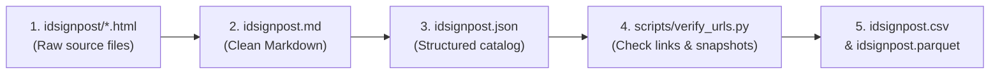

# Biodiversity ID signpost: what this project does

This repository preserves and updates the **Biodiversity ID signpost**, a directory of more than 700 field identification guides for British and Irish wildlife originally published by the Field Studies Council (FSC). 

If you need to find an identification key, chart or guide for plants, insects, fungi or animals in Britain and Ireland, this project gives you a clean, working catalogue.

---

## Why this project exists

Over many years, the Field Studies Council collected recommendations for identification resources. Contributors submitted links to field keys, book handbooks, recording schemes and scientific papers covering groups from caddisflies and beetles to lichens, wildflowers and sea anemones.

When the original website was retired, the live pages disappeared. Even before that, many linked websites had moved or vanished – a common problem known as link rot. 

This project solves two problems:
1. **Preservation:** it recovers every entry from the archived website files and formats them into clean, portable documents.
2. **Link repair:** it tests every web link, finds historical snapshots in the Internet Archive, and searches for current, working replacements when original sites are gone.

---

## What is inside the catalogue

The catalogue contains **736 entries**. Each entry describes an identification resource and includes:

- **Title and author:** the name of the resource and who created it.
- **Description:** summary notes on what organisms the guide covers and how to use it.
- **Availability:** whether the resource is available as a physical book, a web page or a downloadable PDF, and whether it is free.
- **Web link and status:** the original web link, along with its current health status:
  - `ok`: the link works and responds directly.
  - `broken`: the link is confirmed dead (such as a 404 Not Found error).
  - `blocked`: the server blocked automated checks (often due to anti-bot protection).
- **Wayback link:** a direct link to a preserved copy in the Internet Archive's Wayback Machine. More than 500 entries include a working snapshot.
- **Alternative link and score:** for confirmed broken links, a working replacement found by searching publisher and museum archives, paired with a confidence score between 0.0 and 1.0.
- **Alternative note:** the reason the replacement was accepted or rejected. Accepted pages carry a confirmation sentence from the model, and failed searches record why each candidate was dropped.

### Catalogue formats

You can read and use the catalogue in four different formats:

| File | Best for | How to open |
|---|---|---|
| `idsignpost.csv` | Spreadsheets, filtering and sorting | Double-click to open in Microsoft Excel, Google Sheets or Apple Numbers |
| `idsignpost.md` | Reading on screen or browsing on GitHub | Open in any text editor or view directly on GitHub |
| `idsignpost.json` | Programmatic use and web applications | Open in text editors or import into software scripts |
| `idsignpost.parquet` | Fast data analysis and database queries | Load into Python, R, DuckDB or Pandas |

---

## How to find and use identification guides

### Browse in a spreadsheet
1. Open `idsignpost.csv` in Excel or Google Sheets.
2. Turn on filters (**Data** → **Filter**).
3. Filter the **Keywords** or **Title** column by the group you are studying (for example, "spiders", "lichens" or "grasses").
4. Filter **Free** to show only free resources.
5. Click the URL in the **Web link** column to open the resource.

### Open archived copies
If a link in `Web link` does not open or shows an error:
1. Check the **Wayback link** column.
2. Click the link to open an archived snapshot from the Internet Archive.

### Use suggested alternatives
If a link has a `broken` state in **Web link state**:
1. Look at the **Alternative link** column.
2. Check the **Alternative probability** score. A score above 0.6 indicates a strong match where titles, author names and reputable domains align.
3. Click the alternative link to view the relocated guide or modern publisher listing.

---

## How the update pipeline works

The repository contains automated tools that maintain the catalogue. You can run the entire pipeline or individual steps using Python.

1. **Extract text (`extract_idsignpost.py`):** reads the original HTML files in `idsignpost/`, strips website clutter, formats links and generates `idsignpost.md`.
2. **Convert to JSON (`md_to_json.py`):** parses the Markdown catalogue into structured records with distinct fields for titles, authors, descriptions and tags.
3. **Verify links (`verify_urls.py`):** 
   - Tests each link for reachability.
   - Queries the Internet Archive for the closest historical snapshot.
   - For broken links, queries DuckDuckGo for live replacements on recognised natural history domains and scores the candidate.
   - Caches results in `.url_cache.json` so repeat runs complete in seconds.
4. **Export to CSV and Parquet (`json_to_csv.py`, `json_to_parquet.py`):** generates `idsignpost.csv` and `idsignpost.parquet` with consistent column orders and typed values.
