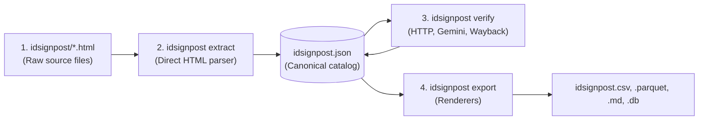

# Biodiversity ID Signpost

This repository preserves and updates the **Biodiversity ID signpost**, a directory of more than 700 field identification guides for British and Irish wildlife originally published by the Field Studies Council (FSC).

If you need to find an identification key, chart, or guide for plants, insects, fungi, or animals in Britain and Ireland, this project gives you a clean, working catalogue.

## Why this project exists

Over many years, the Field Studies Council collected recommendations for identification resources. Contributors submitted links to field keys, handbooks, recording schemes, and scientific papers covering groups from caddisflies and beetles to lichens, wildflowers, and sea anemones.

When the original website was retired, the live pages disappeared. Even before that, many linked websites had moved or vanished, a common problem known as link rot.

This project solves two problems:

1. **Preservation:** it recovers every entry from the archived website files and formats them into clean, portable datasets.
2. **Link repair:** it tests every web link, finds historical snapshots in the Internet Archive, and searches for current, working replacements when original sites are gone.

## Data rescue and clean-up summary

### Before and after

Contributors originally submitted 736 identification guides to the Field Studies Council (FSC) website, and an early archive preserved those raw HTML files (`idsignpost/*.html`). Early helper scripts converted HTML to Markdown and JSON across lossy steps, which dropped verification metadata and misparsed structured fields.

Seven core defects degraded the original dataset before this clean-up:

- **Broken types:** Legacy JSON mixed key casings, stored booleans as strings and switched field types between single strings and lists.
- **Dirty text and URLs:** Double-escaped HTML entities, broken Flickr links and tracking query parameters survived inside titles, descriptions and web links.
- **Cache collisions:** Twenty-seven shared URLs collided in a flat cache, so discovery outputs for one guide overwrote another.
- **Blind redirects:** Any `200 OK` response counted as healthy (`ok`), even when deep links redirected to sign-in screens, error pages or site homepages.
- **Weak fallback links:** Rate-limited web scrapes proposed eBay auctions, used-book listings, SEO spam and dead signpost aliases.
- **Duplicate API calls:** Separate Catalog Entries with identical titles and broken URLs triggered duplicate discovery searches and model checks.
- **Passive archiving:** Seventy-nine live resources had no Wayback Machine snapshot at all.

The clean-slate Python package (`src/idsignpost/`) started from 736 unverified Catalog Entries extracted from the raw archive (`0` live statuses, `0` Wayback snapshots and `0` Alternatives). After initial verification (`93` Alternatives) and two optimisation passes on 24 November 2026, the validated catalogue stands as follows:

| Metric | Pre-optimisation baseline | Validated catalogue (24 November 2026) |
|---|---|---|
| Total Catalog Entries | 736 | 736 |
| Live `web_link` (`ok`) | 386 | 369 (7 Google Sites login walls removed) |
| Dead `web_link` (`broken`) | 290 | 308 |
| Blocked / unverified (`blocked`) | 38 | 37 |
| Entries without a `web_link` | 22 | 22 |
| Confirmed Alternatives | 93 | 227 (+134 recovered) |
| Broken entries with explanatory notes | 289 | 308 (100% coverage) |
| Historical Wayback links | 667 (91%) | 680 (92% of total; 95% of linked) |

Three domain-level **Publisher Pre-Resolver** rules drove most of the Alternative gain without Grounded Search charges:

- **Summerfield Books (`summerfieldbooks.com`):** Rewrites legacy `/<slug>~<id>` links to `/product/<clean-slug>/` and recovered all 16 broken Catalog Entries.
- **Royal Entomological Society (`royensoc.co.uk`):** Queries cached WordPress media and product endpoints once per term and recovered all 70 broken Catalog Entries.
- **Mike's Insect Keys (`sites.google.com/site/mikesinsectkeys`):** Matches legacy paths against the migrated New Google Sites index and recovered 83 of 85 broken Catalog Entries.

### Exemplar Catalog Entries

Five Catalog Entries show the range of HTML repairs, deterministic checks, pre-resolution rules and Grounded Search recoveries across the dataset:

1. **HTML anchor repair and metadata normalisation (`photo-gallery-sciomyzidae-snail-killing-or-marsh-flies`):**
   - **Before:** Raw HTML split the Flickr address outside the anchor tag (`<a href=".../63075200">...</a>@N07/collections/...`), escaped apostrophes as `&#039;` and stored free status and submitter date as raw page labels.
   - **After:** Extraction repaired the full `@N07` Flickr URL, converted fields into strict types (`is_free: true`, `available_as: ["Online"]`, ISO `submitted_at`), confirmed HTTP `200` (`ok`) and attached a 2021 Wayback link.
2. **Hidden sign-in wall caught and migrated (`key-identification-british-histeridae`):**
   - **Before:** Mike Hackston's Classic Google Sites URL redirected with HTTP `200` to `accounts.google.com/v3/signin/...`, so earlier checks wrongly marked the Catalog Entry as `ok`.
   - **After:** Deterministic auth-wall detection flagged `broken` (`redirect_mismatch`). The **Publisher Pre-Resolver** matched the migrated New Google Sites guide at `sites.google.com/view/mikes-insect-keys/...` (`0.95` confidence), kept a 2020 Wayback link and used zero Grounded Searches.
3. **Relocated CMS PDF recovered (`res-handbook-vol-1-part-7-psocoptera`):**
   - **Before:** The Royal Entomological Society link to `/sites/default/files/Archive%204/Vol01_Part07.pdf` failed with HTTP `404` after a site migration.
   - **After:** The **Publisher Pre-Resolver** queried the cached WordPress media endpoint, confirmed `wp-content/uploads/2021/12/Vol01_Part07.pdf` (`0.95` confidence) and preserved a 2021 Wayback snapshot.
4. **Dedicated website homepage recovered via Grounded Search (`spiders-north-west-europe`):**
   - **Before:** The legacy host `ednieuw.home.xs4all.nl` failed (`404`), and earlier rules blocked root homepage Candidates (`/`).
   - **After:** Updated policy rules allowed root homepages on standalone guide websites, so **Grounded Search** on `gemini-3.1-flash-lite` confirmed the migrated site at `https://ednieuw.com/` (`0.95` confidence) alongside a 2026 Wayback snapshot.
5. **Out-of-print handbook resolved to specialist bookseller (`coleoptera-curculionidae-entiminae-broad-nosed-weevils`):**
   - **Before:** The original Field Studies Council shop page returned `404`, and the previous run stopped on `rejected: link returned 403`.
   - **After:** **Grounded Search** excluded general marketplaces (`amazon`, `ebay`, `abebooks`) and confirmed the exact Volume 5 Part 17a listing at `pemberleybooks.com` (`0.60` confidence), paired with a 2023 Wayback snapshot.

### Rescue and validation process

The rescue ran across six controlled stages on `main`:

1. **Direct extraction (`idsignpost extract`):** Parse `idsignpost/*.html` directly into strict Pydantic v2 `CatalogEntry` models (`idsignpost.json`), decode entities, fix split links and strip tracking parameters.
2. **Deterministic URL triage (`http_checker.py`):** Stream up to 16 KB per page via bounded HTTP GET checks and classify authentication-wall redirects as `broken` (`redirect_mismatch`).
3. **Deduplicated caching (`cache.py`):** Store HTTP and Wayback facts in the **URL Tier** and key the **Entry Tier** by normalised title and URL.
4. **Publisher Pre-Resolver stage (`pre_resolver.py`):** Propose migrated URLs for Summerfield Books, the Royal Entomological Society and Mike's Insect Keys before discovery calls run.
5. **Grounded Search and confirmation (`gemini_finder.py`):** Run Google Search via `gemini-3.1-flash-lite` (JSON MIME disabled and `thinking_budget=0` so search triggers), extract Candidates cleanly and verify destination text.
6. **Multi-format export (`idsignpost export`) and verification:** Render deterministic CSV, Parquet and Markdown files, backed by 468 offline `pytest` + `respx` tests, `ruff` lint checks and `ty` type checks.

### Validation cost breakdown

Session tracking in `.idsignpost_costs.json` recorded every API call on 24 November 2026 across two fresh (`--refresh`) validation runs with `gemini-3.1-flash-lite`:

| Run | Operation | API calls | Input tokens | Output tokens | Grounded searches | Nominal USD cost | Nominal GBP cost |
|---|---|---|---|---|---|---|---|
| Pass 1 (full 736 entries, pre-fix) | Redirect checks (`thinking_budget=0`) | 25 | 6,808 | 1,138 | 0 | $0.00341 | £0.00262 |
| Pass 1 (full 736 entries, pre-fix) | Candidate discovery (`thinking_budget=512`, JSON mode) | 82 | 51,224 | 54,266 | 0 | $0.09280 | £0.07120 |
| Pass 1 (full 736 entries, pre-fix) | Alternative confirmations (`thinking_budget=0`) | 223 | 60,139 | 9,831 | 0 | $0.02978 | £0.02285 |
| Pass 2 (`--only-broken`, search fix) | Redirect checks (`thinking_budget=0`) | 11 | 2,459 | 491 | 0 | $0.00135 | £0.00104 |
| Pass 2 (`--only-broken`, search fix) | Discovery (search + JSON extraction) | 149 | 67,436 | 53,700 | 141 | $2.07134 | £1.58913 |
| Pass 2 (`--only-broken`, search fix) | Alternative confirmations (`thinking_budget=0`) | 263 | 69,149 | 11,593 | 0 | $0.03468 | £0.02661 |
| **Combined session total** | **All verification operations** | **753** | **257,215** | **131,019** | **141** | **$2.23335** | **£1.71343** |

GBP conversions use the 24 November 2026 mid-market exchange rate (`$1 USD = £0.7672`). Three engineering choices kept total spend near $2.23 USD (£1.71 GBP) at official list rates (`$0.25/1M` input, `$1.50/1M` output, `$14.00/1k` searches):

- **Deterministic login and pre-resolver gates:** Resolved 176 broken and sign-in entries locally without Grounded Search charges.
- **Disabled reasoning on checks:** Set `thinking_budget=0` on redirect checks, Candidate discoveries and confirmations, which cut thinking tokens on Pass 2 from 45,519 to two tokens.
- **Clean Grounded Search invocation:** Pass 1 revealed that `response_mime_type="application/json"` and non-zero `thinking_budget` suppressed `google_search` (`0` queries across 82 calls). Pass 2 restored live search grounding (`141` queries) while ungrounded confirmations cost less than $0.04 USD (£0.03 GBP) across 263 calls.

## What is inside the catalogue

The catalogue contains **736 entries**. Each entry describes an identification resource and includes:

- **Title and author:** the name of the resource and who created it.
- **Description:** summary notes on what organisms the guide covers and how to use it.
- **Availability:** whether the resource is available as a physical book, a web page, or a downloadable PDF, and whether it is free.
- **Web link and status:** the original web link, along with its health status:
  - `ok`: the link works and responds directly.
  - `broken`: the link is confirmed dead (such as a 404 Not Found error).
  - `blocked`: unverified link (the server blocked automated checks or failed with a Transient Failure). Human-facing exports (`idsignpost.csv`, `idsignpost.parquet` and `idsignpost.md`) relabel this state as `unverified`, while `idsignpost.json` keeps `blocked`.
- **Wayback link:** a direct link to a preserved copy in the Internet Archive's Wayback Machine. Currently, 680 entries (92% of the catalogue, or 95% of entries with a web link) include a working snapshot.
- **Alternative link and score:** for confirmed broken links, a working replacement found by searching publisher and museum archives, paired with a confidence score between 0.0 and 1.0.
- **Alternative note:** the reason the replacement was accepted or rejected. Accepted pages carry a confirmation sentence from the model, and failed searches record why each candidate was dropped.

### Catalogue formats

The catalogue is generated from canonical records in `idsignpost.json` and exported to five formats:

| File | Best for | How to open |
|---|---|---|
| `idsignpost.db` | Interactive search, facets, and SQL views | Open in Datasette (`idsignpost explore`), Datasette Lite, DB Browser for SQLite, or `sqlite3` |
| `idsignpost.csv` | Spreadsheets, filtering, and sorting | Open in Microsoft Excel, Google Sheets, or Apple Numbers |
| `idsignpost.md` | Reading on screen or browsing on GitHub | Open in any text editor or view directly on GitHub |
| `idsignpost.json` | Programmatic use and web applications | Open in text editors or import into software scripts |
| `idsignpost.parquet` | Fast data analysis and database queries | Load into Python, R, DuckDB, Polars, or Pandas |

### Explore interactively in Datasette

You can search all 736 identification guides, facet by format (`Online`, `PDF`, `Publication`), filter link health and run pre-built queries without installing Python tools locally:

- **[Open catalogue in Datasette Lite](https://lite.datasette.io/?url=https%3A%2F%2Fraw.githubusercontent.com%2Fcharlesroper%2FFSCLegacy-fscbiodiversity.uk-idsignpost%2Fmain%2Fidsignpost.db&metadata=https%3A%2F%2Fraw.githubusercontent.com%2Fcharlesroper%2FFSCLegacy-fscbiodiversity.uk-idsignpost%2Fmain%2Fdatasette.metadata.json)** (runs WebAssembly SQLite in your browser directly from `idsignpost.db` and `datasette.metadata.json`).
- **Run locally with one command:** if you cloned the repository and installed `uv`, run:

```bash
uv run idsignpost explore --open
```

`idsignpost explore` uses `datasette` on your `PATH` or falls back automatically to `uvx --from datasette datasette serve` without adding web server dependencies to `pyproject.toml`. Inside Datasette you can use full-text search on `entries` or run the built-in views (`working_guides`, `broken_without_alternative`, `recovered_alternatives`) and canned queries (`search_working_guides`, `free_online_and_pdf_guides`, `link_health_summary`, `recovered_alternatives_by_domain`).

### How to find and use identification guides

#### Browse in a spreadsheet
1. Open `idsignpost.csv` in Excel or Google Sheets.
2. Turn on filters (**Data** → **Filter**).
3. Filter the `keywords` or `title` column by the group you are studying (for example, "spiders", "lichens" or "grasses").
4. Filter `is_free` to `True` to show only free resources.
5. Click the URL in the `web_link` column to open the resource.

#### Open archived copies
If a link in `web_link` does not open or fails:
1. Check the `wayback_link` column.
2. Click the link to open an archived snapshot from the Internet Archive.

#### Use suggested alternatives
If `web_link_state` shows `broken`:
1. Look at the `alternative_link` column.
2. Check the `alternative_probability` score (accepted links meet the `0.40` default minimum, and higher scores indicate stronger matches).
3. Click the URL in `alternative_link` to view the relocated guide or modern publisher listing.

## How the update pipeline works

The repository contains an automated package (`src/idsignpost`) that maintains the catalogue. You can run the entire pipeline or individual steps using `uv`.



1. **Extract records (`uv run idsignpost extract`):** reads the original HTML files in `idsignpost/`, strips website clutter, formats links, and generates canonical `CatalogEntry` records in `idsignpost.json`.
2. **Verify links (`uv run idsignpost verify`):** tests link reachability, detects redirects, queries `gemini-3.1-flash-lite` with Google Search grounding for working replacements, queries the Internet Archive for historical snapshots, and caches results in `.url_cache.json`.
3. **Export files (`uv run idsignpost export`):** renders `idsignpost.csv`, `idsignpost.parquet`, `idsignpost.md`, and `idsignpost.db` directly from the verified catalog.
4. **All-in-one run (`uv run idsignpost run`):** extracts the corpus, verifies selected entries, and exports if verification finishes without aborting.
5. **Explore interactively (`uv run idsignpost explore`):** builds or refreshes `idsignpost.db` when stale and launches Datasette with `datasette.metadata.json`.

## Installation and setup

### Prerequisites

1. **Python 3.12 or newer:**
   Check your version with `python3 --version`. If you do not have Python 3.12+, `uv` can download and manage it for you.

2. **uv (Python package manager):**
   This project uses `uv` to manage virtual environments, Python dependencies, and command execution. If you do not have `uv` installed, install it with:

   ```bash
   # macOS and Linux
   curl -LsSf https://astral.sh/uv/install.sh | sh

   # macOS via Homebrew
   brew install uv

   # Windows via winget
   winget install --id=astral-sh.uv

   # Windows via Scoop
   scoop install uv

   # Windows via PowerShell
   powershell -ExecutionPolicy ByPass -c "irm https://astral.sh/uv/install.ps1 | iex"

   # Cross-platform via pip
   pip install uv
   ```

### Clone and install dependencies

Clone the repository and run `uv sync` to set up the local virtual environment:

```bash
git clone https://github.com/charlesroper/FSCLegacy-fscbiodiversity.uk-idsignpost.git
cd FSCLegacy-fscbiodiversity.uk-idsignpost
uv sync
```

`uv sync` creates a `.venv` directory, installs the exact locked dependencies from `uv.lock`, and installs the `idsignpost` command-line tool in editable mode.

### API key configuration

The verification pipeline uses Google Gemini (`gemini-3.1-flash-lite` with Grounded Search) to inspect ambiguous redirects and find replacements for broken links.

- **Offline tasks:** Extracting HTML (`extract`), rendering exports (`export`), inspecting cost history (`cost`) and running tests (`pytest`) work offline without an API key.
- **Online verification:** To run `verify` or `run`, obtain an API key from [Google AI Studio](https://ai.google.dev/) and set `GEMINI_API_KEY` in a local `.env` file (recommended across shells) or in your current shell session.
- **Wayback Save Page Now (`--save-archive`):** When `--save-archive` is enabled, `verify` and `run` default to authenticated Internet Archive Save Page Now 2 (SPN2) captures using `IA_ACCESS_KEY` and `IA_SECRET_KEY` from [archive.org/account/s3.php](https://archive.org/account/s3.php). Pass `--no-ia-keys` to fall back explicitly to unauthenticated `GET` captures when those keys are absent.

```dotenv
# .env (cross-platform, loaded automatically outside pytest)
GEMINI_API_KEY="your-api-key-here"
IA_ACCESS_KEY="your-ia-access-key"
IA_SECRET_KEY="your-ia-secret-key"
```

```bash
# Bash / Zsh (Ubuntu, macOS, Linux)
export GEMINI_API_KEY="your-api-key-here"
```

```fish
# Fish (Arch, Linux)
set -gx GEMINI_API_KEY "your-api-key-here"
```

```powershell
# PowerShell (Windows)
$env:GEMINI_API_KEY = "your-api-key-here"
```

On startup (outside `pytest`), `idsignpost` reads `.env` from the working directory automatically. The loader ignores blank lines and `#` comments, strips optional `export ` prefixes and leaves existing environment variables unchanged. It also parses single-quoted or double-quoted values and strips inline `#` comments from unquoted values.

## Quick start

Run the CLI commands through `uv run`:

```bash
# Parse legacy HTML into idsignpost.json
uv run idsignpost extract

# Check links, look up snapshots, and find replacements
uv run idsignpost verify

# Render idsignpost.csv, idsignpost.parquet, idsignpost.md, and idsignpost.db
uv run idsignpost export

# Run all three in one pass
uv run idsignpost run

# Open the interactive Datasette catalogue in a browser
uv run idsignpost explore --open
```

`extract --limit 5` prints a sample to stdout instead of writing the catalog. Use `--output` to write a file explicitly.

`run` extracts the whole corpus, verifies the selected entries, and exports only if verification finishes without aborting.

## Verifying a slice

Verification queries external servers and search endpoints, so verifying all 736 entries takes time. Select a smaller set with one of these options:

```bash
# A reproducible cross-section of 40 entries, balanced across link states
uv run idsignpost verify --sample 40

# The first 25 entries in catalog order
uv run idsignpost verify --limit 25

# Only entries already marked broken
uv run idsignpost verify --only-broken
```

`--only-broken` applies before `--sample` or `--limit`. The two selectors cannot be combined. `verify` always loads and writes the full catalog; only the selected entries are rechecked.

Additional options:

- `--refresh`: ignores the cache and rechecks the selected entries.
- `--save-archive`: asks the Wayback Machine to capture live pages that lack a snapshot (using two workers, a 60-second timeout, and authenticated SPN2 via `IA_ACCESS_KEY` and `IA_SECRET_KEY` by default).
- `--no-ia-keys`: allows unauthenticated Wayback Save Page Now `GET` requests when `IA_ACCESS_KEY` and `IA_SECRET_KEY` are not set.
- `--min-prob 0.40`: sets the minimum probability threshold for discovered Candidate URLs (default: `0.40`, range `0.0` to `1.0`).
- `--model`, `--verification-model` and `--discovery-model`: set the default Gemini model (`gemini-3.1-flash-lite`) or assign separate models to verification checks and Grounded Search discovery.
- `--max-searches`: caps Google Search grounding queries across a run to limit search charges.
- `--cost-file`: sets the local session cost ledger path (default: `.idsignpost_costs.json`).
- `--concurrency`, `--wayback-concurrency` and `--gemini-concurrency`: tune HTTP, Wayback and Gemini worker limits.

## Inspecting Gemini costs

`verify` and `run` log token counts and Grounded Search queries to `.idsignpost_costs.json` (gitignored; rolls over after 24 hours of inactivity) and print an itemised cost breakdown when a run finishes.

Inspect or clear the local session ledger with `idsignpost cost`:

```bash
# Show an aligned table of runs and the session total
uv run idsignpost cost

# Output session history as JSON
uv run idsignpost cost --json

# Clear the current session and start fresh
uv run idsignpost cost --reset

# Inspect or reset a custom ledger path
uv run idsignpost cost --cost-file path/to/costs.json
```

## How verification decides

Each entry with a `web_link` passes through five stages:

1. **HTTP status check:** An HTTP GET classifies the link as `ok`, `broken` or `blocked`. `blocked` means unverified (exported as `unverified` in CSV, Parquet and Markdown): the server refused the request or failed with a Transient Failure.
2. **Redirect and soft-404 inspection:** A suspicious redirect (host change, collapse to site root, soft-404 page or login wall) or a non-redirecting `200 OK` page with a soft-404 title or heading is evaluated by Gemini. A confirmed match stays `ok`. A mismatch becomes `broken` with `web_link_status = "redirect_mismatch"`.
3. **Alternative discovery:** For broken links, the pipeline tries the **Publisher Pre-Resolver** first (`summerfieldbooks.com`, `royensoc.co.uk` and `sites.google.com/site/mikesinsectkeys`), then queries Gemini with Grounded Search for up to three ranked Candidate URLs. The verifier filters Candidates against blocked hosts (such as general retail marketplaces), image extensions, multi-resource site homepages, the broken URL and private IP addresses before and after redirects, checks live reachability and asks Gemini to confirm the destination page.
4. **Wayback preservation:** The pipeline queries the Wayback Machine for a snapshot. If a broken link has no historical snapshot, the pipeline checks the confirmed replacement link and captures it via Save Page Now when `--save-archive` is active.
5. **State cleanup:** When the final link state is not `broken`, any obsolete alternative fields are cleared.

Transient Failures never overwrite good results. A network timeout, server error (`429` or `5xx`) or model timeout preserves the previous state for retry on the next run and is omitted from the cache. Pressing `Ctrl+C` during a run flushes `.url_cache.json` and exits with status `130`.

## Two-tier cache

`.url_cache.json` stores verification results across two tiers:

- **URL tier:** Caches network facts about a target URL, including HTTP status, redirect destinations, page titles, and Wayback snapshot URLs. When multiple catalog entries share a URL, the network check runs only once per session.
- **Entry tier:** Caches evaluation verdicts, model reasoning and Alternatives keyed by normalised title and URL, so duplicate Catalog Entries share judgments without repeating discovery.

Cached records expire after 30 days by default (configurable with `--cache-ttl-days`). If the cache schema version changes, outdated caches are automatically invalidated.

## Development and testing

Run the repository quality gate checks:

```bash
uv run ruff check --fix .
uv run ruff format .
uv run ty check
uv run pytest
```

Tests run offline by default and mock network calls with `respx`. To run the optional live smoke test against external endpoints:

```bash
uv run pytest -m live
```

## Documentation

- [`SPEC.md`](SPEC.md): Full technical specification covering pipeline architecture, Pydantic schemas, and caching rules.
- [`NARRATIVE.md`](NARRATIVE.md): Engineering journal documenting design choices, milestones, and implementation history.
- [`plans/`](plans/README.md): Archive of staged execution blueprints and milestone plans.
