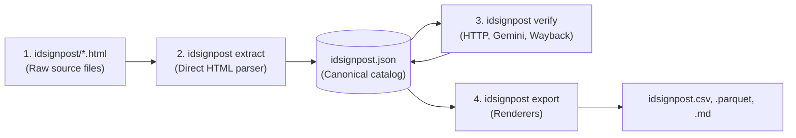

# Biodiversity ID Signpost

[](https://www.python.org/downloads/)
[](https://github.com/astral-sh/uv)
[](https://docs.pydantic.dev/)
[](https://github.com/astral-sh/ruff)
[](https://docs.pytest.org/)
[](LICENSE)

[](#what-is-inside-the-catalogue)
[](#how-verification-decides)
[](#how-verification-decides)
[](#how-verification-decides)
[](https://ai.google.dev/)

This repository preserves and updates the **Biodiversity ID signpost**, a directory of more than 700 field identification guides for British and Irish wildlife originally published by the Field Studies Council (FSC).

If you need to find an identification key, chart, or guide for plants, insects, fungi, or animals in Britain and Ireland, this project gives you a clean, working catalogue.

## Why this project exists

Over many years, the Field Studies Council collected recommendations for identification resources. Contributors submitted links to field keys, handbooks, recording schemes, and scientific papers covering groups from caddisflies and beetles to lichens, wildflowers, and sea anemones.

When the original website was retired, the live pages disappeared. Even before that, many linked websites had moved or vanished, a common problem known as link rot.

This project solves two problems:

1. **Preservation:** it recovers every entry from the archived website files and formats them into clean, portable datasets.
2. **Link repair:** it tests every web link, finds historical snapshots in the Internet Archive, and searches for current, working replacements when original sites are gone.

## What is inside the catalogue

The catalogue contains **736 entries**. Each entry describes an identification resource and includes:

- **Title and author:** the name of the resource and who created it.
- **Description:** summary notes on what organisms the guide covers and how to use it.
- **Availability:** whether the resource is available as a physical book, a web page, or a downloadable PDF, and whether it is free.
- **Web link and status:** the original web link, along with its health status:
  - `ok`: the link works and responds directly.
  - `broken`: the link is confirmed dead (such as a 404 Not Found error).
  - `blocked`: unverified link (the server blocked automated checks or answered with a temporary error).
- **Wayback link:** a direct link to a preserved copy in the Internet Archive's Wayback Machine. Over 660 entries (more than 91%) include a working snapshot.
- **Alternative link and score:** for confirmed broken links, a working replacement found by searching publisher and museum archives, paired with a confidence score between 0.0 and 1.0.
- **Alternative note:** the reason the replacement was accepted or rejected. Accepted pages carry a confirmation sentence from the model, and failed searches record why each candidate was dropped.

### Catalogue formats

The catalogue is generated from canonical records in `idsignpost.json` and exported to four formats:

| File | Best for | How to open |
|---|---|---|
| `idsignpost.csv` | Spreadsheets, filtering, and sorting | Open in Microsoft Excel, Google Sheets, or Apple Numbers |
| `idsignpost.md` | Reading on screen or browsing on GitHub | Open in any text editor or view directly on GitHub |
| `idsignpost.json` | Programmatic use and web applications | Open in text editors or import into software scripts |
| `idsignpost.parquet` | Fast data analysis and database queries | Load into Python, R, DuckDB, Polars, or Pandas |

### How to find and use identification guides

#### Browse in a spreadsheet
1. Open `idsignpost.csv` in Excel or Google Sheets.
2. Turn on filters (**Data** → **Filter**).
3. Filter the **Keywords** or **Title** column by the group you are studying (for example, "spiders", "lichens", or "grasses").
4. Filter **Free** to show only free resources.
5. Click the URL in the **Web link** column to open the resource.

#### Open archived copies
If a link in **Web link** does not open or shows an error:
1. Check the **Wayback link** column.
2. Click the link to open an archived snapshot from the Internet Archive.

#### Use suggested alternatives
If a link has a `broken` state in **Web link state**:
1. Look at the **Alternative link** column.
2. Check the **Alternative probability** score. A score above 0.6 indicates a strong match where titles, author names, and reputable domains align.
3. Click the alternative link to view the relocated guide or modern publisher listing.

## How the update pipeline works

The repository contains an automated package (`src/idsignpost`) that maintains the catalogue. You can run the entire pipeline or individual steps using `uv`.



1. **Extract records (`uv run idsignpost extract`):** reads the original HTML files in `idsignpost/`, strips website clutter, formats links, and generates canonical `CatalogEntry` records in `idsignpost.json`.
2. **Verify links (`uv run idsignpost verify`):** tests link reachability, detects redirects, queries `gemini-3.1-flash-lite` with Google Search grounding for working replacements, queries the Internet Archive for historical snapshots, and caches results in `.url_cache.json`.
3. **Export files (`uv run idsignpost export`):** renders `idsignpost.csv`, `idsignpost.parquet`, and readable `idsignpost.md` directly from the verified catalog.
4. **All-in-one run (`uv run idsignpost run`):** extracts the corpus, verifies selected entries, and exports if verification finishes without aborting.

## Installation and setup

### Prerequisites

1. **Python 3.12 or newer:**
   Check your version with `python3 --version`. If you do not have Python 3.12+, `uv` can download and manage it for you.

2. **uv (Python package manager):**
   This project uses `uv` to manage virtual environments, Python dependencies, and command execution. If you do not have `uv` installed, install it with:

   ```bash
   # macOS and Linux
   curl -LsSf https://astral.sh/uv/install.sh | sh

   # macOS via Homebrew
   brew install uv

   # Windows via winget
   winget install --id=astral-sh.uv

   # Windows via Scoop
   scoop install uv

   # Windows via PowerShell
   powershell -ExecutionPolicy ByPass -c "irm https://astral.sh/uv/install.ps1 | iex"

   # Cross-platform via pip
   pip install uv
   ```

### Clone and install dependencies

Clone the repository and run `uv sync` to set up the local virtual environment:

```bash
git clone https://github.com/your-username/idsignpost.git
cd idsignpost
uv sync
```

`uv sync` creates a `.venv` directory, installs the exact locked dependencies from `uv.lock`, and installs the `idsignpost` command-line tool in editable mode.

### API key configuration

The verification pipeline uses Google Gemini (`gemini-3.1-flash-lite` with Google Search grounding) to inspect ambiguous redirects and discover working replacements for dead links.

- **Offline tasks:** Parsing HTML (`extract`), rendering outputs (`export`), inspecting datasets, and running the test suite work completely offline without an API key.
- **Online verification:** If you run `verify` or `run`, get an API key from [Google AI Studio](https://ai.google.dev/) and set it in your environment:

```bash
export GEMINI_API_KEY="your-api-key-here"
```

## Quick start

Run the CLI commands through `uv run`:

```bash
# Parse legacy HTML into idsignpost.json
uv run idsignpost extract

# Check links, look up snapshots, and find replacements
uv run idsignpost verify

# Render idsignpost.csv, idsignpost.parquet, and idsignpost.md
uv run idsignpost export

# Run all three in one pass
uv run idsignpost run
```

`extract --limit 5` prints a sample to stdout instead of writing the catalog. Use `--output` to write a file explicitly.

`run` extracts the whole corpus, verifies the selected entries, and exports only if verification finishes without aborting.

## Verifying a slice

Verification queries external servers and search endpoints, so verifying all 736 entries takes time. Select a smaller set with one of these options:

```bash
# A reproducible cross-section of 40 entries, balanced across link states
uv run idsignpost verify --sample 40

# The first 25 entries in catalog order
uv run idsignpost verify --limit 25

# Only entries already marked broken
uv run idsignpost verify --only-broken
```

`--only-broken` applies before `--sample` or `--limit`. The two selectors cannot be combined. `verify` always loads and writes the full catalog; only the selected entries are rechecked.

Additional options:

- `--refresh`: ignores the cache and rechecks the selected entries.
- `--save-archive`: asks the Wayback Machine to capture live pages that lack a snapshot (using two workers and a 60 second timeout).
- `--min-prob 0.6`: sets the confidence threshold required before accepting an AI-discovered replacement link.
- `--model`, `--concurrency`, `--wayback-concurrency`, and `--gemini-concurrency`: tune client models and network concurrency limits.

## How verification decides

Each entry with a `web_link` passes through five stages:

1. **HTTP status check:** An HTTP GET classifies the link as `ok`, `broken`, or `blocked`. `blocked` means unverified: the server refused the request or returned a temporary network error.
2. **Redirect inspection:** A suspicious redirect (host change, collapse to site root, soft-404 page, or login wall) is evaluated by Gemini. A confirmed match stays `ok`. A mismatch becomes `broken` with `web_link_status = "redirect_mismatch"`.
3. **Alternative discovery:** For broken links, the pipeline queries Gemini with Google Search grounding for up to three ranked replacements. Candidates are filtered against known dead hosts, private network addresses, the original URL, and live reachability before an alternative is accepted.
4. **Wayback preservation:** The pipeline queries the Wayback Machine for a snapshot. If a broken link has no historical snapshot, the pipeline checks the confirmed replacement link and captures it via Save Page Now when `--save-archive` is active.
5. **State cleanup:** When the final link state is not `broken`, any obsolete alternative fields are cleared.

Temporary failures never overwrite good results. A network timeout or server error (5xx) preserves the previous state for retry on a subsequent run and is not stored in the cache.

## Two-tier cache

`.url_cache.json` stores verification results across two tiers:

- **URL tier:** Caches network facts about a target URL, including HTTP status, redirect destinations, page titles, and Wayback snapshot URLs. When multiple catalog entries share a URL, the network check runs only once per session.
- **Entry tier:** Caches per-entry evaluation verdicts, model reasoning, and replacement links.

Cached records expire after 30 days by default (configurable with `--cache-ttl-days`). If the cache schema version changes, outdated caches are automatically invalidated.

## Development and testing

Run the repository quality gate checks:

```bash
uv run ruff check --fix .
uv run ruff format .
uv run ty check
uv run pytest
```

Tests run offline by default and mock network calls with `respx`. To run the optional live smoke test against external endpoints:

```bash
uv run pytest -m live
```

## Documentation

- [`SPEC.md`](SPEC.md): Full technical specification covering pipeline architecture, Pydantic schemas, and caching rules.
- [`NARRATIVE.md`](NARRATIVE.md): Engineering journal documenting design choices, milestones, and implementation history.
