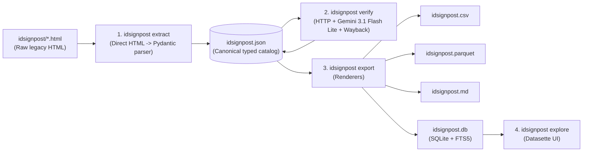
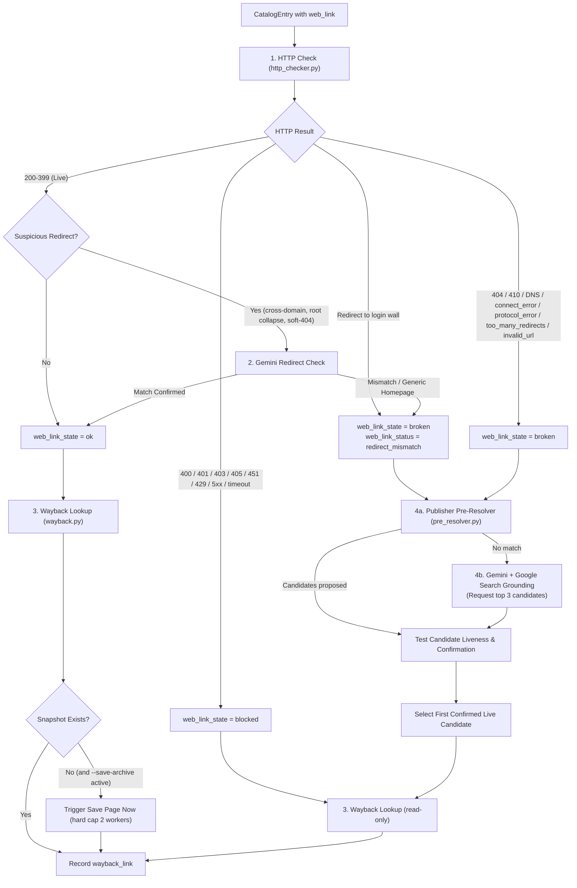

# Technical Specification: `idsignpost` Pipeline (Clean-Slate Architecture)

This document specifies the clean-slate architecture, data schemas, verification workflows, CLI commands, and testing standards for the `idsignpost` package.

---

## 1. Rationale for Starting from Scratch

The legacy `scripts/` directory grew into a brittle chain of ad-hoc scripts (`extract_idsignpost.py`, `md_to_json.py`, `verify_urls.py`, `json_to_csv.py`, `json_to_parquet.py`, `url_utils.py`). Auditing those scripts and the resulting data revealed six fundamental design flaws:

1. **Lossy HTML-to-Markdown-to-JSON round-tripping:** `extract_idsignpost.py` converted HTML into Markdown (`idsignpost.md`), and `md_to_json.py` used regular expressions and indentation heuristics to parse that Markdown back into JSON. Because Markdown was generated before verification, `idsignpost.md` never included link health, Wayback snapshots, or alternative URLs.
2. **Inconsistent, weakly typed schema:** `idsignpost.json` mixed casing styles (`filename` vs `Title` vs `Author(s)`), stored booleans as `"Yes"`/`"No"` strings, combined submitter and date into a single semicolon-delimited string, and allowed fields like `Available as` to switch arbitrarily between `str` and `list[str]`.
3. **Duplicate-URL cache collisions:** Among the 714 entries with a web link, 27 URLs are shared across multiple distinct guides. Because the legacy verifier keyed in-flight tasks and `.url_cache.json` solely by `url`, entry-specific alternative searches overwrote one another when two guides shared a broken link.
4. **Fragile DuckDuckGo scraping and poor matches:** Scraping DuckDuckGo via `ddgs` suffered from rate limits, and token-overlap heuristics matched broken resource links to eBay listings (`ebay.co.uk`), German used-book sites (`zvab.com`), SEO spam blogs (`nextbookinorder.com`), and self-referential signpost pages (`tombio.uk/idsignpost/...`).
5. **Unchecked redirects:** The legacy checker followed HTTP redirects blindly and marked any `200 OK` response as `"ok"`, even when a deep guide URL redirected to a generic site homepage (`/`) or a soft-404 page.
6. **Passive archival coverage:** Of the 318 working (`ok`) links, 79 had no Wayback Machine snapshot (`null`), because the legacy script never triggered new captures.

To eliminate this brittleness, we discard the `scripts/` directory and `ddgs` dependency entirely and build a first-class, installable Python 3.12+ package (`src/idsignpost/`).

---

## 2. Package Architecture and Data Flow

### 2.1 End-to-End Pipeline Flow

`idsignpost.json` serves as the single canonical data store backed by strict Pydantic models:



### 2.2 Repository Layout

```
idsignpost/
├── pyproject.toml               # Package definition (uv_build backend), CLI script entrypoint
├── uv.lock
├── AGENTS.md                    # Agent engineering and prose rules
├── SPEC.md                      # This technical specification
├── NARRATIVE.md                 # Running engineering journal
├── README.md                    # Project documentation and guide
├── plans/                       # Milestone blueprints and archive
├── .github/workflows/pages.yml  # GitHub Pages deployment for static explorer + catalog data
├── datasette.metadata.json      # Curated Datasette facets, FTS config and canned queries
├── idsignpost/                  # Raw scraped legacy HTML files (input source)
├── idsignpost.json              # Canonical structured catalog (generated & enriched)
├── idsignpost.csv               # Tabular export for spreadsheets (generated)
├── idsignpost.parquet           # Columnar export for analytics (generated)
├── idsignpost.md                # Readable Markdown catalog with verification data (generated)
├── idsignpost.db                # Self-contained SQLite + FTS5 catalog (generated)
├── src/
│   └── idsignpost/
│       ├── __init__.py
│       ├── models.py            # Pydantic schemas, validation and immutable verification merge helpers
│       ├── urls.py              # RFC 3986 sanitization, tracking-param stripping, host normalization
│       ├── extract.py           # Direct HTML -> CatalogEntry parser (replaces extract_idsignpost & md_to_json)
│       ├── http_checker.py      # Async HTTP liveness, login-wall & redirect checks, and HTML metadata extraction
│       ├── gemini_finder.py     # Three-method Gemini adapter with thinking budgets and marketplace blocklist
│       ├── pre_resolver.py      # Deterministic Publisher Pre-Resolver before Grounded Search
│       ├── cost.py              # Official Gemini token/search pricing and local 24h session cost tracking
│       ├── wayback.py           # Wayback Availability API lookup and Save Page Now capture
│       ├── cache.py             # Two-tier atomic JSON cache (UrlRecord, EntryRecord, title+URL deduplication)
│       ├── sampler.py           # Deterministic stratified cross-section sampler
│       ├── pipeline.py          # Async Verifier, VerifyConfig, VerifyDeps, run_verification and Candidate evaluation
│       ├── export.py            # Exporters for JSON, CSV, Apache Parquet, Markdown, and SQLite
│       ├── cli.py               # Unified CLI (`uv run idsignpost <command>`) and .env loader
│       └── web/                 # Static zero-WASM GitHub Pages directory UI (index.html, styles.css, app.js)
└── tests/
    ├── fixtures/                # Small HTML fixtures for extraction and URL edge cases
    ├── test_models.py           # Schema validation, status values, duplicate id rejection and immutable merges
    ├── test_urls.py
    ├── test_extract.py
    ├── test_http_checker.py
    ├── test_gemini_finder.py
    ├── test_pre_resolver.py     # Offline respx tests for Publisher Pre-Resolver rules and run caching
    ├── test_cost.py
    ├── test_wayback.py
    ├── test_cache.py
    ├── test_sampler.py
    ├── test_export.py
    ├── test_pipeline.py         # Orchestration, Candidate evaluation, VerifyConfig and run_verification
    ├── test_cli.py              # Option wiring, .env loading, interrupt handling and exit codes
    ├── test_web.py              # Static explorer schema field alignment, DuckDB link and Pages workflow checks
    └── test_live_smoke.py       # Optional @pytest.mark.live end-to-end checks
```

`pyproject.toml` targets Python 3.12+, uses the `uv_build` backend and declares `pydantic`, `httpx`, `beautifulsoup4`, `markdownify`, `google-genai` and `pyarrow`, plus the dev dependencies `pytest`, `pytest-asyncio`, `respx`, `ruff` and `ty`. Pytest is configured with `addopts = "-m 'not live'"`, `asyncio_mode = "auto"` and a registered `live` marker.

---

## 3. Canonical Data Schema (`src/idsignpost/models.py`)

Every record in `idsignpost.json` is validated by the `CatalogEntry` Pydantic model using consistent `snake_case` field names and normalized types:

```python
from typing import Literal
from pydantic import BaseModel, ConfigDict, Field

LinkState = Literal["ok", "broken", "blocked"]

class CatalogEntry(BaseModel):
    model_config = ConfigDict(extra="forbid")

    # Identity and source metadata
    id: str                                      # Slug derived from filename (e.g. "bats-flight")
    filename: str                                # Original HTML file (e.g. "bats-flight.html")
    title: str                                   # Resource title
    submitted_by: str | None = None              # Submitter username
    submitted_at: str | None = None              # ISO 8601 timestamp ("YYYY-MM-DDTHH:MM:SS")

    # Descriptive metadata
    description: str | None = None               # Clean Markdown summary of the resource
    authors: str | None = None                   # Author string as listed on the resource
    is_free: bool | None = None                  # Normalized boolean (True for "Yes", False for "No")
    available_as: list[str] = Field(default_factory=list)  # Always a list (e.g. ["Online", "PDF"])
    keywords: str | None = None                  # Taxonomic and subject keywords
    comment_body: str | None = None              # Legacy comment body, if present

    # Links
    web_link: str | None = None                  # Primary normalized RFC 3986 URL
    additional_web_links: list[str] = Field(default_factory=list)

    # Verification and archival results
    web_link_status: str | None = None           # Decimal HTTP code ("200", "404") or canonical error string ("connect_error", "timeout", "protocol_error", "too_many_redirects", "invalid_url", "http_error", "redirect_mismatch")
    web_link_state: LinkState | None = None      # "ok", "broken", "blocked", or None when no verification exists
    web_link_resolved: str | None = None         # Final destination URL if redirected to a different host or path
    wayback_link: str | None = None              # Closest https://web.archive.org/web/... snapshot URL (for web_link, or alternative_link fallback)
    alternative_link: str | None = None          # Verified live replacement URL (only when web_link_state == "broken")
    alternative_probability: float | None = Field(default=None, ge=0.0, le=1.0)  # Confidence score in [0.0, 1.0]
    alternative_reasoning: str | None = None     # One-sentence justification from Gemini for the chosen URL
    alternative_note: str | None = None          # Confirmation sentence, rejection summary, or negative search outcome
    verified_at: str | None = None               # ISO 8601 UTC timestamp of last verification
```

`id` is unique across the catalog. Duplicate ids are a fatal error at load and merge time. `web_link_status` uses decimal status strings for HTTP responses and the canonical error strings listed above; no other values are allowed.

`models.py` also defines `VERIFICATION_FIELDS`, `CANONICAL_STATUS_ERRORS`, `ensure_unique_ids`, `load_catalog`, `merge_verification` and `merge_verified`. Both merge helpers share an immutable `model_copy` update path that carries forward verification fields when `web_link` is unchanged and clears all nine `VERIFICATION_FIELDS` whenever `web_link` changes. `extract.py` re-exports `merge_verification` and `pipeline.py` re-exports `merge_verified` for compatibility.

---

## 4. Pipeline Stages in Detail

### 4.1 Stage 1: Direct HTML Extraction (`extract.py`)

`extract.py` parses each `*.html` file in `idsignpost/` (excluding `about.html`, case-insensitively) directly into a `CatalogEntry`:

1. **HTML parsing:** Locate `<div id="main">`, strip and extract the `<h1>` text as `title`, and parse `.submitted` with the fixed English format `Submitted by <name> on <weekday>, <DD/MM/YYYY> - <HH:MM>`. Store the naive site-local timestamp as ISO 8601 (`YYYY-MM-DDTHH:MM:SS`). Keep the literal `Anonymous (not verified)` label for anonymous submitters.
2. **Text normalization:** Decode HTML entities twice (legacy pages contain double-escaped `&amp;#13;`), convert `\r` and `\u00a0` to normal whitespace, and collapse blank lines. Repair split Flickr URLs (`<a href="...">...</a>@N07/...`) and merge any text immediately following the link inside `field-web-link` before converting to Markdown.
3. **Field extraction and normalization:**
   - `field-description` and `body`: Convert inner HTML to clean Markdown using `markdownify`, normalize links with angle brackets (`[text](<url>)`), and strip excess whitespace.
   - `field-free`: Parse `"Yes"` to `True`, `"No"` to `False`, otherwise `None`.
   - `field-available-as`: Collect all `.field-item` elements into a deduplicated `list[str]`.
   - `field-taxa`: Map to `keywords`; `comment-body` maps to `comment_body`.
   - `field-web-link` and `field-additional-web-link`: Extract plain hrefs, resolve relative URLs against `https://www.fscbiodiversity.uk/idsignpost/`, strip tracking parameters (`utm_*`, `fbclid`, `gclid`, `msclkid`, `mc_cid`, `mc_eid`, `ref`, `srsltid`), and RFC 3986-encode via `urls.sanitize_url`. Drop fragments from cache keys only, not from stored URLs.
4. **Identity:** Derive `id` from the filename with a fixed slug rule: drop `.html`, NFKD-normalize to ASCII, lowercase, replace runs of non-alphanumeric characters with `-`, and strip leading and trailing `-`. Assert that all `id` values are unique after extraction.
5. **Verification preservation:** When updating an existing `idsignpost.json`, preserve previously recorded verification fields (`web_link_status` through `verified_at`) for any entry whose `web_link` is unchanged via `models.merge_verification` (re-exported by `extract.py`). Return immutable `CatalogEntry` copies without mutating inputs, and clear those fields when `web_link` changes or becomes `None`.
6. **Additional links:** `additional_web_links` are sanitized and exported but not verified in this iteration.

### 4.2 Stage 2: URL Verification and Discovery (`pipeline.py`)

Verification orchestration is configured by `VerifyConfig` and executed through `run_verification(entries, config, *, deps=None)` using `VerifyDeps` for optional `checker`, `finder`, `wayback`, `generator`, `resolver` and `pre_resolver` overrides:

- `VerifyConfig` validates option ranges (`validate()`), resolves `verification_model_name` and `discovery_model_name` (defaulting to `model`) and selects target Catalog Entries (`select_targets()`, applying `--only-broken` before `--sample` or `--limit`).
- `run_verification` loads `SessionCostTracker` and `CatalogCache`, constructs default `HTTPChecker`, `WaybackClient`, `GeminiFinder` and `PublisherPreResolver` adapters when overrides are not supplied, runs `Verifier.verify(targets)`, guarantees `aclose()` cleanup on adapters, saves `.url_cache.json` on completion or `KeyboardInterrupt`/`asyncio.CancelledError`, records run costs and returns `(merge_verified(entries, verified), verifier.stats)`.
- `Verifier` accepts `cache`, `checker` (`Checker`), `finder` (`Finder`), `wayback` (`Archive`), concurrency limits, `save_archive`, `refresh`, an optional DNS `resolver` injected into `is_public_http_url` and an optional `pre_resolver` (`PreResolver`).

For each `CatalogEntry` with a non-empty `web_link`:



#### Step 2a: HTTP Liveness and Redirect Analysis (`http_checker.py`)
- Send a bounded streaming `GET` with browser-like `User-Agent`, `Accept` and `Accept-Language` headers. Follow up to 10 redirects. Read at most 16 KB when `Content-Type` is `text/html` to extract `<title>`, `<h1>` and up to 800 characters of body text without downloading large files.
- On `400` or `403`, retry once with `_plain_get` using the same 16 KB `_streaming_get` path and `PLAIN_HEADERS` before recording the verdict. A `403` is not proof of life; WAF or bot filtering can also return `403` for URLs that are actually `404`.
- Classify status codes:
  - `200 <= code < 400`: provisionally `"ok"`, `cacheable = True`.
  - `code in (404, 410)`: `"broken"`, `cacheable = True`.
  - `code in (400, 401, 403, 405, 451)` and any other `4xx` status: `"blocked"`, `cacheable = True`. Blocked means unverified, not healthy.
  - `code in (429, 500, 502, 503, 504)` or `httpx.TimeoutException` or any other unlisted status code: `"blocked"`, `cacheable = False`.
  - `httpx.ConnectError`: `"broken"`, `cacheable = False`. A network outage must not be cached as permanent link rot.
  - `httpx.TooManyRedirects`: `"broken"`, status `too_many_redirects`, `cacheable = True`.
  - `httpx.RemoteProtocolError`: `"broken"`, status `protocol_error`, `cacheable = True`.
  - `httpx.InvalidURL`: `"broken"`, status `invalid_url`, `cacheable = True`.
  - Any other `httpx.HTTPError`: `"blocked"`, status `http_error`, `cacheable = False`.
- Catch per entry. One bad URL must not abort the run.
- **Offline guard:** If at least 10 checks have run and every check failed with `ConnectError` or `TimeoutException` while no `2xx` or `4xx` response was seen, abort the run (`OfflineRunError`) without writing the catalog or the cache.
- Record `web_link_resolved` whenever the final normalized URL differs from `web_link`. Normalize by lowercasing the host, removing default ports, dropping fragments, and ignoring a single trailing slash.
- Deterministically classify authentication redirects (`is_auth_wall_redirect`): when a URL redirects to a known auth host (`accounts.google.com`, `login.microsoftonline.com`) or crosses onto an explicit auth path prefix (`/v3/signin`, `/servicelogin`, `/login`, `/signin`) when the original URL was not on an auth host or auth path, `HTTPChecker.check()` returns `CheckResult(status="redirect_mismatch", state="broken", resolved_url=resolved_url, is_suspicious_redirect=True, ..., cacheable=True)`. Primary links skip `verify_redirect` and proceed to alternative discovery; Candidate links fail before `confirm_alternative`.
- Flag `is_suspicious_redirect = True` for non-auth redirects when `resolved_url is not None` and any of these five conditions hold:
  1. The clean host changed (`clean_host(original) != clean_host(final)`), where clean host means lowercase with a leading `www.` removed.
  2. A non-empty path collapsed to the root of the same host (`is_same_host_root_redirect`).
  3. The destination path or HTML `<title>` contains soft-404 phrases (`"404"`, `"not found"`, `"page not found"`, `"error"`, `"expired"`).
  4. The destination path is a generic hub (`/shop`, `/shop/publications`, `/product-category`, `/resources`, `/search`, `/category`) while the entry `title` names a specific guide.
  5. The destination path or title contains `login`, `signin`, `register`, `subscribe`, `consent` or `cookie`.
- Export `is_explicit_soft_404` (`"404 not found"`, `"page not found"`, `"error 404"` or standalone `\b404\b`) for Candidate pre-confirmation checks, while keeping `_has_soft_404` on non-redirecting `200 OK` primary `web_link` checks (`page_title` and `page_h1`) so primary soft-404 pages are still routed to Gemini redirect verification.
- Transient results (`cacheable = False`) do not overwrite existing `web_link_state`, `web_link_status`, `web_link_resolved` or `wayback_link` on entries that already have a `web_link_state`. On an unverified entry (`web_link_state is None`), record the provisional `web_link_state`, `web_link_status` and `web_link_resolved` (plus `wayback_link` if found) without setting `verified_at` or writing to the cache. Transient entries are retried on the next run.

#### Step 2b: Gemini Adapter Seam, Thinking Budgets and Cost Accounting (`gemini_finder.py`, `cost.py`)
- `Finder` (defined in `pipeline.py`) and `GeminiFinder` expose exactly three model operations: `verify_redirect`, `discover` and `confirm_alternative`.
- Google GenAI SDK calls and token/search metadata extraction are isolated inside `_GenAIGenerator` behind an internal `Generator` protocol accepting `thinking_budget: int | None = None` (`types.ThinkingConfig(thinking_budget=...)`) and returning `GenerationResult` (`text`, `prompt_tokens`, `output_tokens`, `cached_tokens`, `thinking_tokens`, `tool_use_prompt_tokens`, `search_queries`).
- `_GenAIGenerator.generate` reads `thoughts_token_count` (`thinking_tokens`) and `tool_use_prompt_token_count` (`tool_use_prompt_tokens`) from `usage_metadata`.
- `GeminiFinder` uses a typed `tracker: SessionCostTracker | None` with `GeminiOperation` (`Literal["redirect_verification", "candidate_discovery", "candidate_confirmation"]` in `cost.py`) to record per-operation costs:
  - `MODEL_RATES` uses official per-1M token (input, output, cached) and per-1k search rates (`gemini-3.1-flash-lite`: `0.25/1.50/0.025/14.0`; `gemini-3.1-pro`: `2.00/12.00/0.20/14.0`; `gemini-3-flash`: `0.50/3.00/0.05/14.0`; `gemini-2.5-flash-lite`: `0.10/0.40/0.01/35.0`; `gemini-2.5-flash`: `0.30/2.50/0.03/35.0`; `gemini-2.5-pro`: `1.25/10.00/0.125/35.0`), matched by longest prefix (`_SORTED_MODEL_PREFIXES`).
  - `calculate_cost` bills `tool_use_prompt_tokens` at the uncached input rate and `thinking_tokens` at the output rate. Gemini 2.5 (and 2.0/1.5) models bill Search Grounding per grounded prompt (`1` unit when `search_queries > 0`, `$35.00 / 1k`); Gemini 3+ models bill per executed query (`$14.00 / 1k`).
  - `.idsignpost_costs.json` persists `thinking_tokens` and `tool_use_prompt_tokens` per operation and run (defaulting to `0` on legacy logs), and `format_run_summary` / `format_session_table` display combined billed input (`prompt_tokens + tool_use_prompt_tokens`) and billed output (`output_tokens + thinking_tokens`).
- When a live link has `is_suspicious_redirect == True`, `Verifier` acquires `_gemini` only around `finder.verify_redirect(...)`, passing entry metadata (`title`, `authors`, `description`), `web_link`, `web_link_resolved` and extracted page `<title>`, `<h1>` and body snippet to `verification_model` (default: `gemini-3.1-flash-lite`) with `thinking_budget=0` and `search=False`.
- Google Search grounding is disabled for redirect verification (`search=False`). The check evaluates the fetched destination text directly, incurring token-only costs.
- If Gemini confirms the page still hosts or offers the guide, keep `web_link_state = "ok"`.
- If Gemini determines the redirect landed on an unrelated page or generic homepage, set `web_link_state = "broken"` and `web_link_status = "redirect_mismatch"`, then proceed to alternative discovery.
- Cache the verdict in the Entry Tier via `CatalogCache.update_entry`. If Gemini fails transiently, keep the previous state and retry on the next run.

#### Step 2c: Publisher Pre-Resolution, Grounded Discovery and Candidate Evaluation (`pre_resolver.py`, `gemini_finder.py`, `pipeline.py`)
- Executed **only** when `web_link_state == "broken"`.
- `GeminiFinder.discover(entry, *, hint=None)` queries `discovery_model` (default: `gemini-3.1-flash-lite`) with `thinking_budget=0`, `json_mode=False` and Google Search grounding enabled (`search=True`, attaching `types.Tool(google_search=types.GoogleSearch())`), bounded across the run by `--max-searches`. Disabling `response_mime_type="application/json"` and thinking on the grounded search call ensures `gemini-3.1-flash-lite` triggers live `google_search` queries cleanly.
- `DISCOVERY_PROMPT` includes `current_date`, `title`, `authors`, `description`, `available_as`, `keywords`, broken `web_link` and optional `hint`, requests up to three verified live Candidate URLs from today's search results with confidence and reasoning, forbids `site:` search queries against the broken entry's own dead host, and lists blocked hosts directly from `BLOCKED_HOSTS`.
- `_generate()` applies a 30-second timeout per attempt and retries `TimeoutError`, `429` and `5xx` up to four total attempts with `1s`, `2s` and `4s` backoff. `discover()` executes at most one Grounded Search attempt (no outer JSON-parse retry loop), extracts structured JSON from grounded prose via a lightweight follow-up `json_mode=True, search=False, thinking_budget=0` call (`EXTRACTION_PROMPT`) whenever direct `parse_candidates()` misses prose containing URLs, and filters Candidates with `probability < min_probability` (default `0.40`).
- `Verifier` owns discovery orchestration (`_discover`, `_evaluate_candidates`, `_evaluate_candidate`, `_reconfirm`, `_policy_note`, `_url_policy_note`), keeping HTTP checks out of `_gemini`:
  1. Try any previously stored `entry.alternative_link` first.
  2. Next, if `Verifier.pre_resolver` is set (default `PublisherPreResolver` via `run_verification`), call `pre_resolver.resolve(entry)` before invoking Grounded Search and evaluate any proposed Candidates through the same liveness and confirmation loop. When a pre-resolved Candidate confirms, record the Alternative and skip `finder.discover()` with zero Grounded Search queries:
     - **Summerfield Books (`summerfieldbooks.com`):** Rewrite legacy `/<slug>~<id>` paths (decoding URL escapes, stripping punctuation and trailing dots) to `https://www.summerfieldbooks.com/product/<clean-slug>/` with zero HTTP requests.
     - **Royal Entomological Society (`royensoc.co.uk`):** Query cached WordPress `wp/v2/media` and `wp/v2/product` endpoints in memory across the run to propose matching `wp-content/uploads/...` PDFs or `/shop/publications/.../` handbook product pages.
     - **Mike's Insect Keys (`sites.google.com/site/mikesinsectkeys` and `mikesinsectkeys2`):** Fetch and cache the New Google Sites navigation index once per run (`sites.google.com/view/mikes-insect-keys/home` with fallback to `/mikes-insect-keys` and bounded taxon sub-indexes) and match against the entry path slug and title.
  3. Otherwise acquire `_gemini` and call `finder.discover(entry)`.
  4. Pre-check policy (`_policy_note`): accept only `http` and `https`, reject blocked hosts (`fscbiodiversity.uk`, `tombio.uk`, `archive.org`, `web.archive.org`, `ebay.co.uk`, `ebay.com`, `zvab.com`, `scribd.com`, `amazon.co.uk`, `amazon.com`, `abebooks.co.uk`, `abebooks.com`, `alibris.co.uk`, `alibris.com`, `waterstones.com`, `foyles.co.uk`, `blackwells.co.uk`, `wordery.com`, `bookshop.org` by exact host or dot-suffix while keeping specialist natural-history booksellers `nhbs.com`, `pemberleybooks.com` and `summerfieldbooks.com` allowed), reject direct image URLs, allow standalone domain root homepages (`/`) while rejecting root URLs on `MULTI_RESOURCE_HOSTS` or same-host broken paths, reject URLs equal to the broken `web_link` and reject userinfo or non-public IP addresses via `is_public_http_url` (using `Verifier._resolver` when injected). Rejections record `"ignored: <reason>"`.
  5. Strip fragments via `cache_key` and run cached liveness through `Verifier._facts` (reusing the URL Tier cache, respecting `HTTPChecker.should_abort()` and incrementing `VerifyStats.checked` and `VerifyStats.cache_hits`). Transient HTTP errors record `"retry: transient check failure"` and skip caching. Non-`ok` responses (including login-wall `redirect_mismatch`) record `"rejected: link returned <status-or-state>"`.
  6. Apply post-redirect `_policy_note` on `result.resolved_url`, then check `_pre_confirmation_rejection_note`: allow `200 OK` Candidates that redirected across domains or carry incidental `is_suspicious_redirect` flags to reach confirmation, pre-rejecting only auth walls (`"rejected: login wall"`), `GENERIC_HUBS` (`"rejected: generic hub page"`), explicit soft-404 titles/headings (`"rejected: soft 404 page"`) and deep-to-same-host-root redirects (`"ignored: site homepage"`).
  7. Acquire `_gemini` and call `finder.confirm_alternative(entry, url=..., page_title=..., page_h1=..., page_snippet=...)` using `verification_model` with `thinking_budget=0` and Google Search disabled (`search=False`). Explicit mismatches record `"rejected: <reason>"`. Failed confirmation requests do not reject a live Candidate. Confirmed pages record `"confirmed: <reasoning>"` (when reasoning is present) and store the resolved URL as `alternative_link`.
  8. Pick the first Candidate that passes all checks. On a failed search, store up to the first three `"ignored:"`, `"rejected:"` or `"retry:"` notes (or `"no candidates returned"` / `"search failed"`) in `alternative_note`.
- After the run, `_drop_shared_alternatives` drops any `alternative_link` assigned to three or more entries, restores the original URL's Wayback snapshot and calls `cache.drop_alternative(..., "dropped: URL shared by three or more entries")`.
- Confirmed cached Alternatives (`record.alternative_confirmed`) still pass pure URL policy rules (`_url_policy_note`, without DNS or HTTP I/O) before reuse. Cached Alternatives without `alternative_confirmed` pass `_reconfirm()` through `_evaluate_candidate`, ensuring full policy, liveness and confirmation checks apply identically across discovery and cache reuse.
- Cache settled verdicts, including negative verdicts, via `CatalogCache.update_entry`. Do not cache transient Gemini or HTTP errors.

#### Step 2d: Wayback Lookup and Save Page Now (`wayback.py` and `pipeline.py`)
- `Verifier._resolve_wayback(url, *, allow_save: bool) -> str | None` unifies Wayback resolution across primary `web_link` URLs and Alternative links, returning cached snapshots (unless `refresh=True`) before querying `archive.org` and preserving existing cached snapshots if a refresh lookup finds none.
- Query `https://archive.org/wayback/available?url=<encoded_url>` under a dedicated semaphore (`wayback_concurrency`, default `2`). Use three attempts with `2s` and `4s` backoff. On failure, keep any existing `wayback_link`.
- Accept only snapshots whose `closest.status` is `"200"`. Ignore redirect and error snapshots.
- Upgrade `http://web.archive.org/...` snapshot URLs to `https://`.
- If no snapshot exists, `web_link_state == "ok"`, and `--save-archive` is enabled:
  - By default, require `IA_ACCESS_KEY` and `IA_SECRET_KEY` and submit captures via the authenticated Save Page Now 2 (SPN2) JSON API (`POST https://web.archive.org/save` with `Authorization: LOW <IA_ACCESS_KEY>:<IA_SECRET_KEY>` and `Accept: application/json`), polling `GET https://web.archive.org/save/status/<job_id>` up to the 60-second budget until `status == "success"` (`https://web.archive.org/web/<timestamp>/<original_url>`).
  - When `--no-ia-keys` is passed, fall back explicitly to unauthenticated `GET https://web.archive.org/save/<url>` and extract the snapshot URL from the final redirect URL or `Content-Location` header.
  - Enforce a hard cap of two concurrent captures independent of `--wayback-concurrency`, and handle `429` or `401`/`403` responses by skipping the capture for this run without failing verification.
- If an entry is `broken`, its original `web_link` has no Wayback snapshot, and a confirmed non-transient `alternative_link` exists:
  - Call `_resolve_wayback(alternative_link, allow_save=self.save_archive)`, storing any found or captured snapshot in `wayback_link` and caching it under `alternative_link` in the URL Tier.
- `blocked` links get a read-only lookup. `blocked` entries do not get alternative discovery; this is a known blind spot.
- If the final state is not `broken`, clear `alternative_link`, `alternative_probability`, `alternative_reasoning` and `alternative_note`.

### 4.3 Stage 3: Multi-Format Exporters (`export.py`)

All output formats are rendered directly from the validated `list[CatalogEntry]` in `idsignpost.json`:

1. **`idsignpost.json`:** Pretty-printed (2-space indent) array of `CatalogEntry` objects.
2. **`idsignpost.csv`:** UTF-8 CSV using the canonical `snake_case` column order, joining list fields (`available_as`, `additional_web_links`) with `"; "`.
3. **`idsignpost.parquet`:** Apache Parquet table written via `pyarrow` with native column types:
   - `is_free`: `pa.bool_()`
   - `available_as`, `additional_web_links`: `pa.list_(pa.string())`
   - `alternative_probability`: `pa.float64()`
   - All other fields: `pa.string()`
4. **`idsignpost.md`:** Human-readable Markdown catalog where each entry is rendered under `## <filename>` with clean bullet points, including `Web link`, `Web link state`, `Wayback link`, and `Alternative link` (when present).
5. **`idsignpost.db`:** Self-contained SQLite database (stdlib `sqlite3`, no new runtime dependencies) structured for interactive exploration in Datasette:
   - `entries`: Primary table mirroring CSV/Parquet columns (`is_free` as integer `0`/`1`, `available_as` and `additional_web_links` as JSON arrays, `alternative_probability` as `REAL`, `web_link_state` mapped to `"unverified"` for `"blocked"`), indexed on `web_link_state`, `is_free`, `submitted_at`, and `web_link_status`.
   - `entry_formats` and `entry_additional_links`: Normalised child tables with `FOREIGN KEY (entry_id) REFERENCES entries(id)` so multi-value formats and links facet cleanly in Datasette.
   - `entries_fts`: External-content `FTS5` virtual table indexing `title`, `description`, `authors`, `keywords`, `comment_body`, and `available_as` with insert/delete/update triggers.
   - Views: `working_guides` (entries with `web_link_state = 'ok'` or a verified `alternative_link`, resolving a single `best_url`), `broken_without_alternative`, and `recovered_alternatives`.

All exporters write through `atomic_write` (creating missing parent directories, writing a temporary file in the destination directory, applying the caller's umask, and atomically replacing the target with `Path.replace`; `write_sqlite` closes the SQLite connection and temp file descriptor before calling `Path.replace`). JSON entries are sorted by `id`. CSV uses Python's `csv` module with `newline=""`. Markdown indents multi-line values by two spaces. Human-facing exports (`idsignpost.csv`, `idsignpost.parquet`, `idsignpost.md` and `idsignpost.db`) label `blocked` as `unverified`, while `idsignpost.json` keeps the canonical `blocked` state.

---

## 5. Two-Tier Atomic Cache (`cache.py`)

`.url_cache.json` prevents duplicate network requests and eliminates cross-entry collisions by separating URL-scoped facts from entry-scoped verdicts:

```json
{
  "schema_version": 2,
  "urls": {
    "https://example.org/guide.pdf": {
      "status": "404",
      "state": "broken",
      "resolved_url": null,
      "is_suspicious_redirect": false,
      "page_title": null,
      "page_h1": null,
      "page_snippet": "Bats in flight identification guide. If you are lucky...",
      "wayback_url": "https://web.archive.org/web/20220101000000/https://example.org/guide.pdf",
      "checked_at": "2026-10-26T00:00:00+00:00"
    }
  },
  "entries": {
    "bats in flight::https://www.nhm.ac.uk/content/dam/nhmwww/take-part/identify-nature/bats-in-flight-id-guide.pdf": {
      "redirect_is_match": null,
      "redirect_reason": null,
      "alternative_url": "https://www.nhm.ac.uk/take-part/identify-nature/bats-in-flight-id-guide.html",
      "alternative_probability": 0.92,
      "alternative_reasoning": "Official Natural History Museum identification guide page for Bats in flight.",
      "alternative_note": "confirmed: official NHM guide page for this resource.",
      "alternative_checked": true,
      "alternative_confirmed": true,
      "checked_at": "2026-10-26T00:00:00+00:00"
    }
  }
}
```

- **URL Tier interface (`get_check`, `put_check`, `get_wayback`, `set_wayback`):** `CatalogCache` exchanges `CheckResult` instances directly with `Verifier` without exposing `UrlRecord` mapping details. `put_check` ignores `cacheable=False` Transient Failures and preserves any existing `wayback_url` across `--refresh` runs.
- **Entry Tier interface (`get_entry`, `put_entry`, `update_entry`, `record_redirect`, `clear_entry`, `drop_alternative`):** All Entry Tier methods accept `(title, url, ..., entry_id=None)`. `update_entry` constructs and persists explicit `EntryRecord` values without implicitly carrying forward prior redirect verdicts, skipping dirty writes when semantic fields are unchanged. `record_redirect` updates redirect verdict fields while preserving any cached Alternative fields (or clears stale redirect state when `is_match` is `None`). `clear_entry` removes stale Entry Tier records when a link recovers or stops redirecting, and `drop_alternative` clears a stored Alternative and caches the negative note while keeping any redirect verdict intact.
- **Key canonicalization and duplicate coordination:** URL-tier and entry-tier keys use the sanitized URL with the fragment removed (`cache_key(url)`). Entry Tier keys use `f"{normalize_title(title)}::{cache_key(url)}"` (`normalize_title` trims, lowercases and collapses whitespace), so Catalog Entries sharing the same title and broken URL reuse verdicts across runs, while `Verifier._verify_group` serialises identical-title subgroups in-run and runs distinct-title subgroups concurrently. When `get_entry` misses the new key and `entry_id` is provided, it checks legacy `f"{entry_id}::{cache_key(url)}"` records and migrates fresh hits in place.
- **Atomic writes:** Cache saves write to a temporary file in the same directory (creating missing parent directories) and atomically replace `.url_cache.json` via `Path.replace`. The canonical catalog and all exports use the same pattern.
- **Transient error exclusion:** Results with `cacheable = False` (HTTP 429, 5xx, connect errors, timeouts, or Wayback API failures) are never written to the cache and do not overwrite existing verified fields.
- **TTL expiration:** Cached records older than `cache_ttl_days` (default `30` days) are automatically refreshed.
- **Schema mismatch:** A cache file whose `schema_version` is not `2` is discarded.
- **Timestamps:** On a cache hit, preserve the existing `verified_at`; update it only when a new check runs.
- **Negative verdicts:** Entry-tier records store failed alternative searches and redirect mismatch verdicts, so a broken entry does not re-query Gemini on every run. Transient Gemini errors are not cached. The `alternative_checked` flag distinguishes a completed search that found nothing from a record that only holds a redirect verdict. The `alternative_confirmed` flag records that a model explicitly matched the page to the entry. A cached alternative without that flag is confirmed once on reuse, then kept or cleared.
- **Search notes:** `alternative_note` records why a result was accepted or rejected. Accepted values start with `confirmed:` and carry the model's sentence. Negative searches carry the first three rejection reasons (`rejected:`, `ignored:`, `retry:`), `no candidates returned` or `search failed` (and `dropped:` when pruned as a shared hub). The note is cached with the entry and copied to the catalog.
- **Save cadence:** Save the cache every 25 checks and on normal exit, `asyncio.CancelledError` or `KeyboardInterrupt`.

---

## 6. Stratified Cross-Section Sampler (`sampler.py`)

`sampler.py` provides `get_stratified_sample(entries: list[CatalogEntry], sample_size: int, seed: int = 42) -> list[CatalogEntry]`:

1. **Eligibility:** Exclude entries without `web_link`; they cannot be verified. Partition the remaining entries into four buckets: `ok`, `broken`, `blocked` and `unverified` (`web_link_state is None`).
2. **Secondary ordering:** Within each state bucket, sort deterministically by `(tuple(entry.available_as), entry.keywords or "", entry.id)`, then draw the quota with `random.Random(seed).sample`. This makes the draw reproducible and spreads formats when the bucket is large; it does not guarantee that every format appears.
3. **Balanced quota allocation:** Allocate `sample_size` evenly across non-empty buckets, redistributing any shortfall from smaller buckets across the remaining buckets. Clamp `sample_size` to the number of eligible entries. Reject `sample_size <= 0`.
4. **Partial catalog merge:** `uv run idsignpost verify --sample N` verifies only the sampled entries, then writes the full catalog with those entries updated by `id`. All other entries stay unchanged. A duplicate or missing `id` is fatal.

---

## 7. Unified CLI Specification (`src/idsignpost/cli.py`)

Registered in `pyproject.toml` under `[project.scripts]` as `idsignpost = "idsignpost.cli:main"`:

```bash
# 1. Extract HTML files into canonical idsignpost.json (or stdout with --limit)
uv run idsignpost extract [--html-dir idsignpost] [--output idsignpost.json] [--limit N]

# 2. Verify URLs, check/create Wayback snapshots, and find alternatives with Gemini
uv run idsignpost verify [OPTIONS]
  --input PATH                Input JSON catalog (default: idsignpost.json)
  --output PATH               Output JSON catalog (default: idsignpost.json)
  --cache-file PATH           Cache file path (default: .url_cache.json)
  --cache-ttl-days INT        Cache TTL in days (default: 30)
  --sample N                  Verify a stratified cross-section of N entries
  --seed INT                  Seed for stratified sampling (default: 42)
  --limit N                   Verify first N entries
  --only-broken               Only verify entries currently marked broken
  --save-archive              Trigger Wayback Save Page Now for unarchived live URLs (off by default)
  --no-ia-keys                Fall back to unauthenticated Save Page Now without IA_ACCESS_KEY and IA_SECRET_KEY
  --refresh                   Ignore cache and force re-verification
  --concurrency INT           Concurrent HTTP workers (default: 10)
  --wayback-concurrency INT   Concurrent Wayback workers (default: 2)
  --gemini-concurrency INT    Concurrent Gemini workers (default: 3)
  --timeout FLOAT             HTTP and Wayback timeout in seconds (default: 10.0; Save Page Now uses 60.0)
  --min-prob FLOAT            Minimum alternative confidence score (default: 0.40, range 0.0 to 1.0)
  --model NAME                Default Gemini model (default: gemini-3.1-flash-lite)
  --verification-model NAME   Gemini model for redirect and confirmation checks (default: matches --model)
  --discovery-model NAME      Gemini model for candidate discovery (default: matches --model)
  --max-searches INT          Maximum Google Search grounding queries allowed across the run
  --cost-file PATH            Cost tracking file path (default: .idsignpost_costs.json)
  -v, --verbose               Enable debug logging

# 3. Export canonical idsignpost.json to CSV, Parquet, Markdown, and SQLite
uv run idsignpost export [--input idsignpost.json] [--csv idsignpost.csv] [--parquet idsignpost.parquet] [--md idsignpost.md] [--sqlite idsignpost.db]

# 4. Run full pipeline (extract -> verify -> export)
uv run idsignpost run [VERIFY_OPTIONS]

# 5. Launch local Datasette web UI against idsignpost.db and datasette.metadata.json
uv run idsignpost explore [--input idsignpost.json] [--sqlite idsignpost.db] [--metadata datasette.metadata.json] [--host 127.0.0.1] [--port 8001] [--open]

# 6. Inspect local session costs and run history
uv run idsignpost cost [--cost-file .idsignpost_costs.json] [--reset] [--json]
```

On startup (unless `PYTEST_CURRENT_TEST` is set), `main()` reads `.env` from the working directory without overwriting existing environment variables. The `.env` parser ignores blank lines and `#` comments, strips optional `export ` prefixes, parses quoted values and strips inline `#` comments from unquoted values.

`GEMINI_API_KEY` is required for `verify` and `run`. When `--save-archive` is active without `--no-ia-keys`, `IA_ACCESS_KEY` and `IA_SECRET_KEY` are also required. Fail fast at startup with a clear message if required keys are missing. Never log any key.

Every subcommand and flag defines `--help` descriptions. `verify` and `run` build a `VerifyConfig` and delegate execution to `pipeline.run_verification`, accepting an optional `VerifyDeps` bundle (`checker`, `finder`, `wayback`, `generator`, `resolver` and `pre_resolver`) for testing without monkeypatching internal hooks.

`verify` requires the canonical schema. Run `extract` first; legacy JSON keys are rejected with a clear error.

`extract --limit N` prints to stdout unless `--output` is given explicitly. It must never truncate the canonical catalog by default. `verify` always loads the full catalog and writes the full catalog, updating only the selected entries. `--sample` and `--limit` are mutually exclusive. `--only-broken` is applied before `--sample` or `--limit`. `--min-prob` must be in `[0, 1]`.

`run` performs a full `extract`, then `verify`, then `export`. `--limit` applies only to verification. Export runs only if verification exits successfully. The exit code is `0` even when broken links remain, `1` on fatal or file errors (including missing, unreadable or corrupt files in `export` and `cost`, or `OfflineRunError`), `2` on invalid usage and `130` on `KeyboardInterrupt` (after flushing `.url_cache.json` and printing `idsignpost <command>: interrupted, URL cache saved` to stderr without a traceback). Print a summary to stderr: counts per state, alternatives found, Wayback captures, cache hits and run cost breakdown.

`--save-archive` is off by default, so the unarchived `ok` links stay unarchived unless the flag is used. Save Page Now captures use a separate 60-second timeout and a hard cap of two workers, independent of `--wayback-concurrency`.

---

## 8. Testing Specification (`tests/`)

All unit and integration tests reside in `tests/` and run offline via `uv run pytest` (collecting 477 offline tests across 14 test files, with `addopts = "-m 'not live'"` and `asyncio_mode = "auto"` configured in `pyproject.toml`, plus one deselected live smoke test). Extraction tests use small fixtures in `tests/fixtures/`, not the full 736-file corpus.

1. **`tests/test_models.py`:** Tests `CatalogEntry` defaults, strict field validation (`extra="forbid"`), `alternative_probability` bounds, canonical HTTP and error status values, timestamp rules (`submitted_at` naive, `verified_at` UTC), `load_catalog`, duplicate `id` rejection, immutable `merge_verification` and `merge_verified` updates and the repository-wide no-em-dash guardrail.
2. **`tests/test_urls.py`:** Tests RFC 3986 sanitisation, relative URL resolution, tracking parameter removal, fragment removal for cache keys, `host_matches` exact/dot-suffix matching, scheme and userinfo rejection and private-address rejection. Split Flickr URL repair is covered in `test_extract.py`.
3. **`tests/test_extract.py`:** Tests direct HTML-to-`CatalogEntry` extraction against fixtures, covering double entity decoding (`&amp;#13;`), NBSP normalisation, `is_free` conversion, list normalisation (`available_as`), ISO date parsing with the fixed submitted format, Unicode filename slugs, split Flickr URLs, relative links and duplicate `id` rejection.
4. **`tests/test_http_checker.py`:** Uses `respx` to test status classification (`200`, `400`, `403`, `404`, `429`, `503`), bounded 16 KB streaming `400`/`403` retries, `<title>` and `<h1>` extraction, redirect loops, protocol errors, deterministic login-wall `redirect_mismatch` classification, suspicious redirect detection (cross-domain, root path collapse, soft-404 titles, login pages), explicit vs primary soft-404 detection and the offline guard.
5. **`tests/test_gemini_finder.py`:** Injects a single `FakeGenerator` at the `Generator` transport seam to verify `verify_redirect` (`thinking_budget=0`), `discover` (`thinking_budget=0`, `json_mode=False`, prose-to-JSON extraction via `EXTRACTION_PROMPT`, `min_probability` filtering, `hint`, `DISCOVERY_PROMPT` rules, single-attempt failure on malformed non-URL output), `confirm_alternative` (`thinking_budget=0`), expanded retail marketplace blocklist (`notebay.co.uk` and specialist natural-history booksellers must pass), `ThinkingConfig` wiring and `usage_metadata` token extraction (`thoughts_token_count`, `tool_use_prompt_token_count`), `429`/`5xx`/`TimeoutError` backoff retries, `--max-searches` caps and `SessionCostTracker` recording.
6. **`tests/test_pre_resolver.py`:** Uses `respx` fixtures to verify `PublisherPreResolver` slug rewriting for `summerfieldbooks.com`, WordPress media and product lookups for `royensoc.co.uk`, New Google Sites index parsing for `sites.google.com/site/mikesinsectkeys` (including `404` `/home` fallback and `mikesinsectkeys2`), concurrency-safe per-run caching and graceful HTTP/parse error handling.
7. **`tests/test_cost.py`:** Tests `GeminiOperation` coverage, official `MODEL_RATES` and longest-prefix lookups, `thinking_tokens` and `tool_use_prompt_tokens` billing, Gemini 2.5 per-prompt vs Gemini 3+ per-query search pricing, `SessionCostTracker` persistence with legacy `0` defaults, strict loading on corrupt or directory paths, combined `in`/`out` reporting in run summaries and session tables, 24-hour session rollover and session resets.
8. **`tests/test_wayback.py`:** Uses `respx` to test Availability API lookups, `closest.status == "200"` filtering, `http` to `https` normalisation, retry logic and Save Page Now capture (both authenticated SPN2 POST/polling and unauthenticated fallback) with its 60-second timeout and 429 handling.
9. **`tests/test_cache.py`:** Verifies atomic disk writes, `get_check` and `put_check` round-trips, Wayback snapshot preservation on `--refresh`, transient failure exclusion, `(normalize_title(title), url)` Entry Tier keys, transparent migration from legacy `<entry_id>::<url>` records, `update_entry` explicit updates and dirty-write skipping, `record_redirect` preservation of cached Alternatives, `clear_entry`, `drop_alternative`, TTL expiry, v1 cache discard and URL-tier/entry-tier isolation.
10. **`tests/test_sampler.py`:** Verifies exclusion of entries without `web_link`, stratified sampling across all four buckets (`ok`, `broken`, `blocked`, `unverified`), shortfall redistribution, clamping and seed reproducibility.
11. **`tests/test_export.py`:** Verifies JSON, CSV, Parquet (schema and column types via `pyarrow`), Markdown, and SQLite (normalised tables, `FTS5` search, views, and clean file replacement) generation from `CatalogEntry` models, deterministic byte output, `blocked` to `unverified` display mapping, CSV quoting of embedded newlines and quotes and `atomic_write` parent directory creation.
12. **`tests/test_pipeline.py`:** Tests `Verifier.verify`, `VerifyConfig`, `VerifyDeps` and `run_verification` with fake adapters and temporary-file `CatalogCache` instances: live links, deterministic login-wall rejection without Gemini calls, redirect checks, broken-link discovery, `PublisherPreResolver` hit and fallback paths, duplicate same-title entry coordination vs distinct-title URL Tier sharing, cross-domain `200 OK` and standalone homepage Candidate confirmation, generic-hub / same-host-root / soft-404 Candidate pre-rejection, cached Candidate liveness and stats, Gemini semaphore scoping, `refresh=True` Wayback preservation and duplicate coordination, stale redirect cleanup on `--refresh` and recovery, shared-hub pruning, `KeyboardInterrupt` cache saving, offline aborts and cost tracking.
13. **`tests/test_cli.py`:** Tests real CLI wiring via `VerifyDeps` without monkeypatching internal hooks: `extract --limit` stdout output, `verify` full-catalog merge, model and search flag wiring, `--sample` and `--limit` mutual exclusion, `--only-broken` ordering, `--sqlite` export wiring, `explore` auto-build and `datasette`/`uvx` fallback launch, `.env` parsing (`export ` prefixes and unquoted inline `#` comments), `--help` flag coverage, error exit codes (`1` and `2`) including corrupt or directory cost files and `KeyboardInterrupt` exit code `130`.
14. **`tests/test_web.py`:** Verifies that `src/idsignpost/web/` assets exist without em-dashes, every `entry.<field>` access in `app.js` matches `CatalogEntry.model_fields`, all `getElementById` calls resolve in `index.html`, external guide links enforce `noopener noreferrer`, the DuckDB Web Shell hash encodes `FSCLegacy-fscbiodiversity.uk-idsignpost` cleanly under `extraswaps` and `.github/workflows/pages.yml` bundles all catalog exports alongside the static frontend.
15. **`tests/test_live_smoke.py` (`@pytest.mark.live`):** Deselected by default; run via `uv run pytest -m live` to test a small stratified sample against live endpoints.
