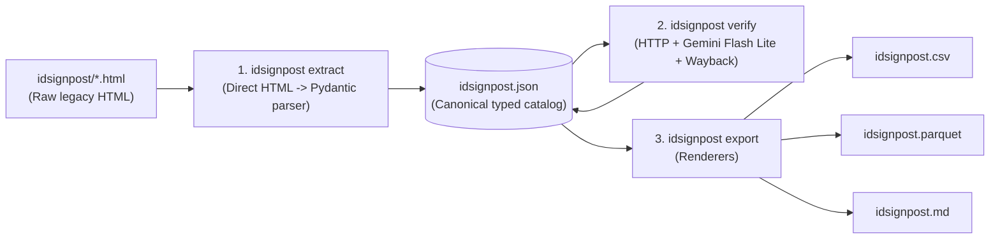
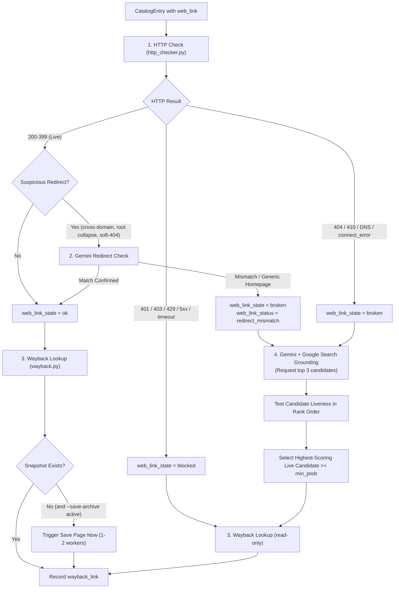

# Technical Specification: `idsignpost` Pipeline (Clean-Slate Architecture)

This document specifies the clean-slate architecture, data schemas, verification workflows, CLI commands, and testing standards for the `idsignpost` package.

---

## 1. Rationale for Starting from Scratch

The legacy `scripts/` directory grew into a brittle chain of ad-hoc scripts (`extract_idsignpost.py`, `md_to_json.py`, `verify_urls.py`, `json_to_csv.py`, `json_to_parquet.py`, `url_utils.py`). Auditing those scripts and the resulting data revealed six fundamental design flaws:

1. **Lossy HTML-to-Markdown-to-JSON round-tripping:** `extract_idsignpost.py` converted HTML into Markdown (`idsignpost.md`), and `md_to_json.py` used regular expressions and indentation heuristics to parse that Markdown back into JSON. Because Markdown was generated before verification, `idsignpost.md` never included link health, Wayback snapshots, or alternative URLs.
2. **Inconsistent, weakly typed schema:** `idsignpost.json` mixed casing styles (`filename` vs `Title` vs `Author(s)`), stored booleans as `"Yes"`/`"No"` strings, combined submitter and date into a single semicolon-delimited string, and allowed fields like `Available as` to switch arbitrarily between `str` and `list[str]`.
3. **Duplicate-URL cache collisions:** Among the 714 entries with a web link, 27 URLs are shared across multiple distinct guides. Because the legacy verifier keyed in-flight tasks and `.url_cache.json` solely by `url`, entry-specific alternative searches overwrote one another when two guides shared a broken link.
4. **Fragile DuckDuckGo scraping and poor matches:** Scraping DuckDuckGo via `ddgs` suffered from rate limits, and token-overlap heuristics matched broken resource links to eBay listings (`ebay.co.uk`), German used-book sites (`zvab.com`), SEO spam blogs (`nextbookinorder.com`), and self-referential signpost pages (`tombio.uk/idsignpost/...`).
5. **Unchecked redirects:** The legacy checker followed HTTP redirects blindly and marked any `200 OK` response as `"ok"`, even when a deep guide URL redirected to a generic site homepage (`/`) or a soft-404 page.
6. **Passive archival coverage:** Of the 318 working (`ok`) links, 79 had no Wayback Machine snapshot (`null`), because the legacy script never triggered new captures.

To eliminate this brittleness, we discard the `scripts/` directory and `ddgs` dependency entirely and build a first-class, installable Python 3.12+ package (`src/idsignpost/`).

---

## 2. Package Architecture and Data Flow

### 2.1 End-to-End Pipeline Flow

`idsignpost.json` serves as the single canonical data store backed by strict Pydantic models:



### 2.2 Repository Layout

```
idsignpost/
├── pyproject.toml               # Package definition, uv_build/hatchling backend, CLI script entrypoint
├── uv.lock
├── AGENTS.md                    # Agent engineering and prose rules
├── SPEC.md                      # This technical specification
├── NARRATIVE.md                 # Running engineering journal
├── README.md                    # Technical documentation
├── EXPLAINER.md                 # Layperson guide to the catalog
├── idsignpost/                  # Raw scraped legacy HTML files (input source)
├── idsignpost.json              # Canonical structured catalog (generated & enriched)
├── idsignpost.csv               # Tabular export for spreadsheets (generated)
├── idsignpost.parquet           # Columnar export for analytics (generated)
├── idsignpost.md                # Readable Markdown catalog with verification data (generated)
├── src/
│   └── idsignpost/
│       ├── __init__.py
│       ├── models.py            # Pydantic schemas for CatalogEntry, VerificationResult, and Gemini outputs
│       ├── urls.py              # RFC 3986 sanitization, tracking-param stripping, host normalization
│       ├── extract.py           # Direct HTML -> CatalogEntry parser (replaces extract_idsignpost & md_to_json)
│       ├── http_checker.py      # Async HTTP liveness, redirect analysis, and HTML <title>/<h1> extraction
│       ├── gemini_finder.py     # Gemini 2.0 Flash Lite client with Google Search grounding
│       ├── wayback.py           # Wayback Availability API lookup and Save Page Now capture
│       ├── cache.py             # Two-tier atomic JSON cache (URL-level and entry-level)
│       ├── sampler.py           # Deterministic stratified cross-section sampler
│       ├── pipeline.py          # Async verification orchestrator
│       ├── export.py            # Exporters for JSON, CSV, Apache Parquet, and Markdown
│       └── cli.py               # Unified CLI (`uv run idsignpost <command>`)
└── tests/
    ├── conftest.py
    ├── test_urls.py
    ├── test_extract.py
    ├── test_http_checker.py
    ├── test_gemini_finder.py
    ├── test_wayback.py
    ├── test_cache.py
    ├── test_sampler.py
    ├── test_export.py
    └── test_live_smoke.py       # Optional @pytest.mark.live end-to-end checks
```

---

## 3. Canonical Data Schema (`src/idsignpost/models.py`)

Every record in `idsignpost.json` is validated by the `CatalogEntry` Pydantic model using consistent `snake_case` field names and normalized types:

```python
from typing import Literal
from pydantic import BaseModel, Field

LinkState = Literal["ok", "broken", "blocked"]

class CatalogEntry(BaseModel):
    # Identity and source metadata
    id: str                                      # Slug derived from filename (e.g. "bats-in-flight")
    filename: str                                # Original HTML file (e.g. "bats-in-flight.html")
    title: str                                   # Resource title
    submitted_by: str | None = None              # Submitter username
    submitted_at: str | None = None              # ISO 8601 timestamp ("YYYY-MM-DDTHH:MM:SS")

    # Descriptive metadata
    description: str | None = None               # Clean Markdown summary of the resource
    authors: str | None = None                   # Author string as listed on the resource
    is_free: bool | None = None                  # Normalized boolean (True for "Yes", False for "No")
    available_as: list[str] = Field(default_factory=list)  # Always a list (e.g. ["Online", "PDF"])
    keywords: str | None = None                  # Taxonomic and subject keywords
    comment_body: str | None = None              # Legacy comment body, if present

    # Links
    web_link: str | None = None                  # Primary normalized RFC 3986 URL
    additional_web_links: list[str] = Field(default_factory=list)

    # Verification and archival results
    web_link_status: str | None = None           # HTTP code ("200", "404") or error ("connect_error", "redirect_mismatch")
    web_link_state: LinkState | None = None      # "ok", "broken", "blocked", or None if web_link is None
    web_link_resolved: str | None = None         # Final destination URL if redirected to a different host or path
    wayback_link: str | None = None              # Closest https://web.archive.org/web/... snapshot URL
    alternative_link: str | None = None          # Verified live replacement URL (only when web_link_state == "broken")
    alternative_probability: float | None = None # Confidence score in [0.0, 1.0]
    alternative_reasoning: str | None = None     # One-sentence justification from Gemini
    verified_at: str | None = None               # ISO 8601 UTC timestamp of last verification
```

---

## 4. Pipeline Stages in Detail

### 4.1 Stage 1: Direct HTML Extraction (`extract.py`)

`extract.py` parses each `*.html` file in `idsignpost/` (excluding `about.html`) directly into a `CatalogEntry`:

1. **HTML parsing:** Locate `<div id="main">`, extract the `<h1>` text as `title`, and parse `.submitted` into `submitted_by` and `submitted_at` (ISO 8601).
2. **Broken link repair:** Repair split Flickr URLs (`<a href="...">...</a>@N07/...`) before converting field HTML to text or Markdown.
3. **Field extraction and normalization:**
   - `field-description` and `body`: Convert inner HTML to clean Markdown using `markdownify`, normalize links with angle brackets (`[text](<url>)`), and strip excess whitespace.
   - `field-free`: Parse `"Yes"` to `True`, `"No"` to `False`, otherwise `None`.
   - `field-available-as`: Collect all `.field-item` elements into a deduplicated `list[str]`.
   - `field-web-link` and `field-additional-web-link`: Extract plain hrefs, resolve relative URLs against `https://www.fscbiodiversity.uk/idsignpost/`, strip tracking parameters, and RFC 3986-encode via `urls.sanitize_url`.
4. **Verification preservation:** When updating an existing `idsignpost.json`, preserve previously recorded verification fields (`web_link_status` through `verified_at`) for any entry whose `web_link` has not changed.

### 4.2 Stage 2: URL Verification and Discovery (`pipeline.py`)

For each `CatalogEntry` with a non-empty `web_link`:



#### Step 2a: HTTP Liveness and Redirect Analysis (`http_checker.py`)
- Perform a bounded streaming `GET` request (reading up to 16 KB of body when `Content-Type` is `text/html` to extract `<title>` and `<h1>` without downloading large PDFs).
- Classify status codes:
  - `200 <= code < 400`: Provisionally `"ok"`, `cacheable = True`.
  - `code in (404, 410)` or `httpx.ConnectError` after 2 attempts: `"broken"`, `cacheable = True`.
  - `code in (401, 403)`: `"blocked"`, `cacheable = True`.
  - `code in (429, 500, 502, 503, 504)` or `httpx.TimeoutException`: `"blocked"`, `cacheable = False` (transient error; retried next run).
- Record `web_link_resolved` whenever the final normalized host or path differs from `web_link`.
- Flag `is_suspicious_redirect = True` if:
  1. The clean host changed (`clean_host(original) != clean_host(final)`).
  2. A non-empty path collapsed to the site root (`/`).
  3. The destination path or HTML `<title>` contains soft-404 phrases (`"404"`, `"not found"`, `"page not found"`, `"error"`, `"expired"`).
  4. The URL points to a generic hub path while the entry `title` names a specific guide.

#### Step 2b: Gemini Redirect Verification (`gemini_finder.py`)
- When a live link has `is_suspicious_redirect == True`, pass the entry metadata (`title`, `authors`, `description`), `web_link`, `web_link_resolved`, and extracted page `<title>` / `<h1>` to `gemini-3.1-flash-lite`.
- If Gemini confirms the page still hosts or offers the guide, keep `web_link_state = "ok"`.
- If Gemini determines the redirect landed on an unrelated page or generic homepage, set `web_link_state = "broken"` and `web_link_status = "redirect_mismatch"`, then proceed to alternative discovery.

#### Step 2c: Grounded Alternative Discovery (`gemini_finder.py`)
- Executed **only** when `web_link_state == "broken"`.
- Query `gemini-3.1-flash-lite` via `google-genai` with Google Search grounding enabled (`tools=[types.Tool(google_search=types.GoogleSearch())]`).
- Prompt with `title`, `authors`, `description`, `available_as`, `keywords`, and the broken `web_link`, requesting up to 3 ranked candidates (`url`, `probability`, `reasoning`).
- Filter and verify candidates in rank order:
  1. Reject blocked domains (`fscbiodiversity.uk`, `tombio.uk`, `archive.org`, `web.archive.org`, `ebay.co.uk`, `ebay.com`, `zvab.com`).
  2. Reject URLs identical to the broken `web_link`.
  3. Strip tracking parameters.
  4. Run `HTTPChecker.check` on the candidate URL; require `state == "ok"` and not a suspicious homepage redirect.
  5. Pick the highest-scoring live candidate with `probability >= min_probability` (default `0.40`).

#### Step 2d: Wayback Lookup and Save Page Now (`wayback.py`)
- Query `https://archive.org/wayback/available?url=<encoded_url>` under a dedicated semaphore (`wayback_concurrency`, default `2`).
- Upgrade `http://web.archive.org/...` snapshot URLs to `https://`.
- If no snapshot exists, `web_link_state == "ok"`, and `--save-archive` is enabled:
  - Trigger `https://web.archive.org/save/<url>` with polite rate limiting (1 to 2 concurrent workers).
  - Extract the new snapshot URL from the final redirect URL or `Content-Location` header and store it in `wayback_link`.

### 4.3 Stage 3: Multi-Format Exporters (`export.py`)

All output formats are rendered directly from the validated `list[CatalogEntry]` in `idsignpost.json`:

1. **`idsignpost.json`:** Pretty-printed (2-space indent) array of `CatalogEntry` objects.
2. **`idsignpost.csv`:** UTF-8 CSV using the canonical ` snake_case` column order, joining list fields (`available_as`, `additional_web_links`) with `"; "`.
3. **`idsignpost.parquet`:** Apache Parquet table written via `pyarrow` with native column types:
   - `is_free`: `pa.bool_()`
   - `available_as`, `additional_web_links`: `pa.list_(pa.string())`
   - `alternative_probability`: `pa.float64()`
   - All other fields: `pa.string()`
4. **`idsignpost.md`:** Human-readable Markdown catalog where each entry is rendered under `## <filename>` with clean bullet points, including `Web link`, `Web link state`, `Wayback link`, and `Alternative link` (when present).

---

## 5. Two-Tier Atomic Cache (`cache.py`)

`.url_cache.json` prevents duplicate network requests and eliminates cross-entry collisions by separating URL-scoped facts from entry-scoped verdicts:

```json
{
  "schema_version": 2,
  "urls": {
    "https://example.org/guide.pdf": {
      "status": "404",
      "state": "broken",
      "resolved_url": null,
      "is_suspicious_redirect": false,
      "page_title": null,
      "wayback_url": "https://web.archive.org/web/20220101000000/https://example.org/guide.pdf",
      "checked_at": "2026-10-26T00:00:00+00:00"
    }
  },
  "entries": {
    "bats-in-flight::https://www.nhm.ac.uk/content/dam/nhmwww/take-part/identify-nature/bats-in-flight-id-guide.pdf": {
      "redirect_is_match": null,
      "redirect_reason": null,
      "alternative_url": "https://www.nhm.ac.uk/take-part/identify-nature/bats-in-flight-id-guide.html",
      "alternative_probability": 0.92,
      "alternative_reasoning": "Official Natural History Museum identification guide page for Bats in flight.",
      "checked_at": "2026-10-26T00:00:00+00:00"
    }
  }
}
```

- **Atomic writes:** Cache saves write to a temporary file in the same directory and atomically replace `.url_cache.json` via `Path.replace`.
- **Transient error exclusion:** Results with `cacheable = False` (HTTP 429, 5xx, timeouts, or Wayback API failures) are never written to the cache.
- **TTL expiration:** Cached records older than `cache_ttl_days` (default `30` days) are automatically refreshed.

---

## 6. Stratified Cross-Section Sampler (`sampler.py`)

`sampler.py` provides `get_stratified_sample(entries: list[CatalogEntry], sample_size: int, seed: int = 42) -> list[CatalogEntry]`:

1. **Primary stratification (Link State):** Partition entries into 4 buckets: `ok`, `broken`, `blocked`, and `missing` (no `web_link`).
2. **Secondary stratification (Format & Keywords):** Within each state bucket, sort deterministically by `(tuple(entry.available_as), entry.keywords or "", entry.id)` before shuffling with `random.Random(seed)` so the sample covers diverse media types (`Online`, `PDF`, `Publication`, `App`) and taxonomic groups.
3. **Balanced quota allocation:** Allocate `sample_size` evenly across non-empty buckets, redistributing any shortfall from smaller buckets across the remaining buckets.
4. **Partial catalog merge:** When `uv run idsignpost verify --sample N` runs, only the sampled entries are verified, and their updated models are merged back into `idsignpost.json` by `id`.

---

## 7. Unified CLI Specification (`src/idsignpost/cli.py`)

Registered in `pyproject.toml` under `[project.scripts]` as `idsignpost = "idsignpost.cli:main"`:

```bash
# 1. Extract HTML files directly into canonical idsignpost.json
uv run idsignpost extract [--html-dir idsignpost] [--output idsignpost.json] [--limit N]

# 2. Verify URLs, check/create Wayback snapshots, and find alternatives with Gemini
uv run idsignpost verify [OPTIONS]
  --input PATH                Input JSON catalog (default: idsignpost.json)
  --output PATH               Output JSON catalog (default: idsignpost.json)
  --cache-file PATH           Cache file path (default: .url_cache.json)
  --sample N                  Verify a stratified cross-section of N entries
  --seed INT                  Seed for stratified sampling (default: 42)
  --limit N                   Verify first N entries
  --only-broken               Only verify entries currently marked broken
  --save-archive              Trigger Wayback Save Page Now for unarchived live URLs
  --refresh                   Ignore cache and force re-verification
  --concurrency INT           Concurrent HTTP workers (default: 10)
  --wayback-concurrency INT   Concurrent Wayback workers (default: 2)
  --gemini-concurrency INT    Concurrent Gemini workers (default: 3)
  --timeout FLOAT             HTTP timeout in seconds (default: 10.0)
  --min-prob FLOAT            Minimum alternative confidence score (default: 0.40)
  --model NAME                Gemini model (default: gemini-3.1-flash-lite)
  -v, --verbose               Enable debug logging

# 3. Export canonical idsignpost.json to CSV, Parquet, and Markdown
uv run idsignpost export [--input idsignpost.json] [--csv idsignpost.csv] [--parquet idsignpost.parquet] [--md idsignpost.md]

# 4. Run full pipeline (extract -> verify -> export)
uv run idsignpost run [VERIFY_OPTIONS]
```

---

## 8. Testing Specification (`tests/`)

All unit and integration tests reside in `tests/` and run offline in milliseconds via `uv run pytest`:

1. **`tests/test_urls.py`:** Tests RFC 3986 sanitization, relative URL resolution, tracking parameter removal, and split Flickr URL repair.
2. **`tests/test_extract.py`:** Tests direct HTML-to-`CatalogEntry` extraction against sample legacy HTML fixtures, verifying boolean conversion (`is_free`), list normalization (`available_as`), and ISO date parsing.
3. **`tests/test_http_checker.py`:** Uses `respx` to test status classification (`200`, `403`, `404`, `429`, `503`, timeouts), `<title>` extraction from streaming GET responses, and suspicious redirect detection (cross-domain, root path collapse, soft-404 titles).
4. **`tests/test_gemini_finder.py`:** Mocks `google-genai` responses to verify candidate ranking, domain blocklist filtering (`fscbiodiversity.uk`, `tombio.uk`, `archive.org`, `ebay.co.uk`, `zvab.com`), fallback when candidate #1 is dead, and redirect verification verdicts.
5. **`tests/test_wayback.py`:** Uses `respx` to test Availability API lookups, `http` to `https` normalization, retry logic, and Save Page Now capture for unarchived live URLs.
6. **`tests/test_cache.py`:** Verifies atomic disk writes, TTL expiry, transient error exclusion, and isolation between URL-tier and entry-tier cache keys when two entries share a URL.
7. **`tests/test_sampler.py`:** Verifies stratified sampling across link states and formats, shortfall redistribution, and seed reproducibility.
8. **`tests/test_export.py`:** Verifies JSON, CSV, Parquet (schema and column types via `pyarrow`), and Markdown generation from `CatalogEntry` models.
9. **`tests/test_live_smoke.py` (`@pytest.mark.live`):** Deselected by default; run via `uv run pytest -m live` to test a small stratified sample against live endpoints.
