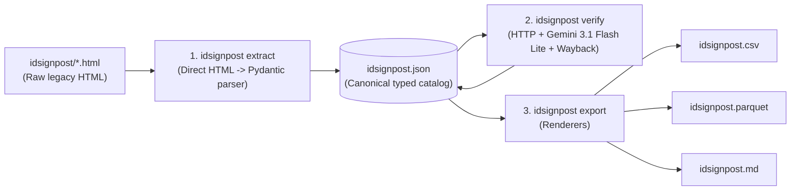
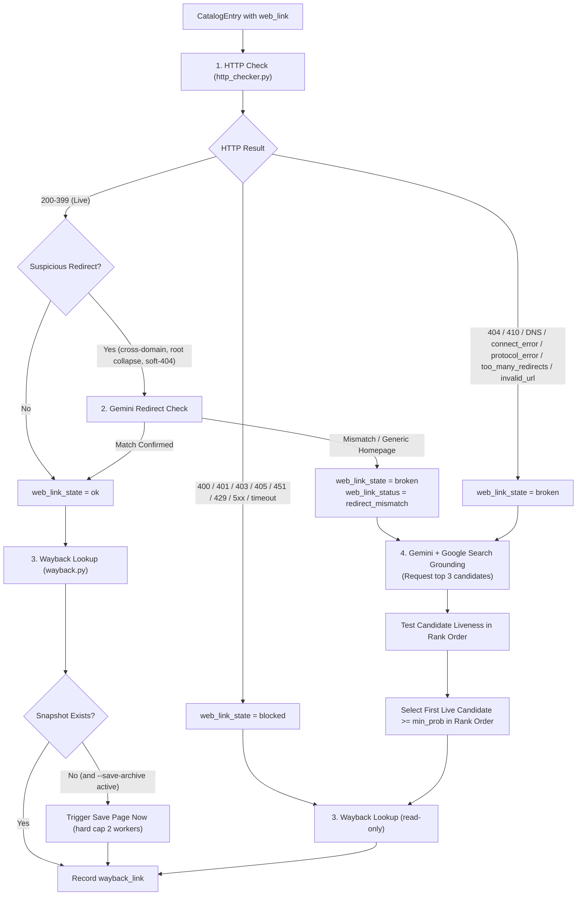

# Technical Specification: `idsignpost` Pipeline (Clean-Slate Architecture)

This document specifies the clean-slate architecture, data schemas, verification workflows, CLI commands, and testing standards for the `idsignpost` package.

---

## 1. Rationale for Starting from Scratch

The legacy `scripts/` directory grew into a brittle chain of ad-hoc scripts (`extract_idsignpost.py`, `md_to_json.py`, `verify_urls.py`, `json_to_csv.py`, `json_to_parquet.py`, `url_utils.py`). Auditing those scripts and the resulting data revealed six fundamental design flaws:

1. **Lossy HTML-to-Markdown-to-JSON round-tripping:** `extract_idsignpost.py` converted HTML into Markdown (`idsignpost.md`), and `md_to_json.py` used regular expressions and indentation heuristics to parse that Markdown back into JSON. Because Markdown was generated before verification, `idsignpost.md` never included link health, Wayback snapshots, or alternative URLs.
2. **Inconsistent, weakly typed schema:** `idsignpost.json` mixed casing styles (`filename` vs `Title` vs `Author(s)`), stored booleans as `"Yes"`/`"No"` strings, combined submitter and date into a single semicolon-delimited string, and allowed fields like `Available as` to switch arbitrarily between `str` and `list[str]`.
3. **Duplicate-URL cache collisions:** Among the 714 entries with a web link, 27 URLs are shared across multiple distinct guides. Because the legacy verifier keyed in-flight tasks and `.url_cache.json` solely by `url`, entry-specific alternative searches overwrote one another when two guides shared a broken link.
4. **Fragile DuckDuckGo scraping and poor matches:** Scraping DuckDuckGo via `ddgs` suffered from rate limits, and token-overlap heuristics matched broken resource links to eBay listings (`ebay.co.uk`), German used-book sites (`zvab.com`), SEO spam blogs (`nextbookinorder.com`), and self-referential signpost pages (`tombio.uk/idsignpost/...`).
5. **Unchecked redirects:** The legacy checker followed HTTP redirects blindly and marked any `200 OK` response as `"ok"`, even when a deep guide URL redirected to a generic site homepage (`/`) or a soft-404 page.
6. **Passive archival coverage:** Of the 318 working (`ok`) links, 79 had no Wayback Machine snapshot (`null`), because the legacy script never triggered new captures.

To eliminate this brittleness, we discard the `scripts/` directory and `ddgs` dependency entirely and build a first-class, installable Python 3.12+ package (`src/idsignpost/`).

---

## 2. Package Architecture and Data Flow

### 2.1 End-to-End Pipeline Flow

`idsignpost.json` serves as the single canonical data store backed by strict Pydantic models:



### 2.2 Repository Layout

```
idsignpost/
├── pyproject.toml               # Package definition (uv_build backend), CLI script entrypoint
├── uv.lock
├── AGENTS.md                    # Agent engineering and prose rules
├── SPEC.md                      # This technical specification
├── NARRATIVE.md                 # Running engineering journal
├── README.md                    # Project documentation and guide
├── plans/                       # Milestone blueprints and archive
├── idsignpost/                  # Raw scraped legacy HTML files (input source)
├── idsignpost.json              # Canonical structured catalog (generated & enriched)
├── idsignpost.csv               # Tabular export for spreadsheets (generated)
├── idsignpost.parquet           # Columnar export for analytics (generated)
├── idsignpost.md                # Readable Markdown catalog with verification data (generated)
├── src/
│   └── idsignpost/
│       ├── __init__.py
│       ├── models.py            # Pydantic schemas for CatalogEntry, cache records, and Gemini outputs
│       ├── urls.py              # RFC 3986 sanitization, tracking-param stripping, host normalization
│       ├── extract.py           # Direct HTML -> CatalogEntry parser (replaces extract_idsignpost & md_to_json)
│       ├── http_checker.py      # Async HTTP liveness, redirect analysis, and HTML <title>/<h1> extraction
│       ├── gemini_finder.py     # Gemini 3.1 Flash Lite client with Google Search grounding
│       ├── wayback.py           # Wayback Availability API lookup and Save Page Now capture
│       ├── cache.py             # Two-tier atomic JSON cache (URL-level and entry-level)
│       ├── sampler.py           # Deterministic stratified cross-section sampler
│       ├── pipeline.py          # Async verification orchestrator
│       ├── export.py            # Exporters for JSON, CSV, Apache Parquet, and Markdown
│       └── cli.py               # Unified CLI (`uv run idsignpost <command>`)
└── tests/
    ├── fixtures/                # Small HTML fixtures for extraction and URL edge cases
    ├── test_models.py           # Schema validation, status values, and duplicate id rejection
    ├── test_urls.py
    ├── test_extract.py
    ├── test_http_checker.py
    ├── test_gemini_finder.py
    ├── test_wayback.py
    ├── test_cache.py
    ├── test_sampler.py
    ├── test_export.py
    ├── test_pipeline.py         # Orchestration, merging, and overwrite rules
    ├── test_cli.py              # Option precedence and exit codes
    └── test_live_smoke.py       # Optional @pytest.mark.live end-to-end checks
```

`pyproject.toml` targets Python 3.12+, uses the `uv_build` backend, and declares `pydantic`, `httpx`, `beautifulsoup4`, `markdownify`, `google-genai`, `pyarrow`, plus the dev dependencies `pytest`, `respx`, `ruff`, and `ty`. Pytest is configured with `addopts = "-m 'not live'"` and a registered `live` marker.

---

## 3. Canonical Data Schema (`src/idsignpost/models.py`)

Every record in `idsignpost.json` is validated by the `CatalogEntry` Pydantic model using consistent `snake_case` field names and normalized types:

```python
from typing import Literal
from pydantic import BaseModel, ConfigDict, Field

LinkState = Literal["ok", "broken", "blocked"]

class CatalogEntry(BaseModel):
    model_config = ConfigDict(extra="forbid")

    # Identity and source metadata
    id: str                                      # Slug derived from filename (e.g. "bats-flight")
    filename: str                                # Original HTML file (e.g. "bats-flight.html")
    title: str                                   # Resource title
    submitted_by: str | None = None              # Submitter username
    submitted_at: str | None = None              # ISO 8601 timestamp ("YYYY-MM-DDTHH:MM:SS")

    # Descriptive metadata
    description: str | None = None               # Clean Markdown summary of the resource
    authors: str | None = None                   # Author string as listed on the resource
    is_free: bool | None = None                  # Normalized boolean (True for "Yes", False for "No")
    available_as: list[str] = Field(default_factory=list)  # Always a list (e.g. ["Online", "PDF"])
    keywords: str | None = None                  # Taxonomic and subject keywords
    comment_body: str | None = None              # Legacy comment body, if present

    # Links
    web_link: str | None = None                  # Primary normalized RFC 3986 URL
    additional_web_links: list[str] = Field(default_factory=list)

    # Verification and archival results
    web_link_status: str | None = None           # Decimal HTTP code ("200", "404") or canonical error string ("connect_error", "timeout", "protocol_error", "too_many_redirects", "invalid_url", "http_error", "redirect_mismatch")
    web_link_state: LinkState | None = None      # "ok", "broken", "blocked", or None when no verification exists
    web_link_resolved: str | None = None         # Final destination URL if redirected to a different host or path
    wayback_link: str | None = None              # Closest https://web.archive.org/web/... snapshot URL (for web_link, or alternative_link fallback)
    alternative_link: str | None = None          # Verified live replacement URL (only when web_link_state == "broken")
    alternative_probability: float | None = Field(default=None, ge=0.0, le=1.0)  # Confidence score in [0.0, 1.0]
    alternative_reasoning: str | None = None     # One-sentence justification from Gemini for the chosen URL
    alternative_note: str | None = None          # Confirmation sentence, rejection summary, or negative search outcome
    verified_at: str | None = None               # ISO 8601 UTC timestamp of last verification
```

`id` is unique across the catalog. Duplicate ids are a fatal error at load and merge time. `web_link_status` uses decimal status strings for HTTP responses and the canonical error strings listed above; no other values are allowed.

---

## 4. Pipeline Stages in Detail

### 4.1 Stage 1: Direct HTML Extraction (`extract.py`)

`extract.py` parses each `*.html` file in `idsignpost/` (excluding `about.html`, case-insensitively) directly into a `CatalogEntry`:

1. **HTML parsing:** Locate `<div id="main">`, strip and extract the `<h1>` text as `title`, and parse `.submitted` with the fixed English format `Submitted by <name> on <weekday>, <DD/MM/YYYY> - <HH:MM>`. Store the naive site-local timestamp as ISO 8601 (`YYYY-MM-DDTHH:MM:SS`). Keep the literal `Anonymous (not verified)` label for anonymous submitters.
2. **Text normalization:** Decode HTML entities twice (legacy pages contain double-escaped `&amp;#13;`), convert `\r` and `\u00a0` to normal whitespace, and collapse blank lines. Repair split Flickr URLs (`<a href="...">...</a>@N07/...`) and merge any text immediately following the link inside `field-web-link` before converting to Markdown.
3. **Field extraction and normalization:**
   - `field-description` and `body`: Convert inner HTML to clean Markdown using `markdownify`, normalize links with angle brackets (`[text](<url>)`), and strip excess whitespace.
   - `field-free`: Parse `"Yes"` to `True`, `"No"` to `False`, otherwise `None`.
   - `field-available-as`: Collect all `.field-item` elements into a deduplicated `list[str]`.
   - `field-taxa`: Map to `keywords`; `comment-body` maps to `comment_body`.
   - `field-web-link` and `field-additional-web-link`: Extract plain hrefs, resolve relative URLs against `https://www.fscbiodiversity.uk/idsignpost/`, strip tracking parameters (`utm_*`, `fbclid`, `gclid`, `msclkid`, `mc_cid`, `mc_eid`, `ref`, `srsltid`), and RFC 3986-encode via `urls.sanitize_url`. Drop fragments from cache keys only, not from stored URLs.
4. **Identity:** Derive `id` from the filename with a fixed slug rule: drop `.html`, NFKD-normalize to ASCII, lowercase, replace runs of non-alphanumeric characters with `-`, and strip leading and trailing `-`. Assert that all `id` values are unique after extraction.
5. **Verification preservation:** When updating an existing `idsignpost.json`, preserve previously recorded verification fields (`web_link_status` through `verified_at`) for any entry whose `web_link` is unchanged. Clear those fields when `web_link` changes or becomes `None`.
6. **Additional links:** `additional_web_links` are sanitized and exported but not verified in this iteration.

### 4.2 Stage 2: URL Verification and Discovery (`pipeline.py`)

For each `CatalogEntry` with a non-empty `web_link`:



#### Step 2a: HTTP Liveness and Redirect Analysis (`http_checker.py`)
- Send a bounded streaming `GET` with browser-like `User-Agent`, `Accept`, and `Accept-Language` headers. Follow up to 10 redirects. Read at most 16 KB when `Content-Type` is `text/html` to extract `<title>` and `<h1>` without downloading large PDFs.
- On `400` or `403`, retry once with a plain `GET` before recording the verdict. A `403` is not proof of life; WAF or bot filtering can also return `403` for URLs that are actually `404`.
- Classify status codes:
  - `200 <= code < 400`: provisionally `"ok"`, `cacheable = True`.
  - `code in (404, 410)`: `"broken"`, `cacheable = True`.
  - `code in (400, 401, 403, 405, 451)`: `"blocked"`, `cacheable = True`. Blocked means unverified, not healthy.
  - `code in (429, 500, 502, 503, 504)` or `httpx.TimeoutException`: `"blocked"`, `cacheable = False`.
  - `httpx.ConnectError`: `"broken"`, `cacheable = False`. A network outage must not be cached as permanent link rot.
  - `httpx.TooManyRedirects`: `"broken"`, status `too_many_redirects`, `cacheable = True`.
  - `httpx.RemoteProtocolError`: `"broken"`, status `protocol_error`, `cacheable = True`.
  - `httpx.InvalidURL`: `"broken"`, status `invalid_url`, `cacheable = True`.
  - Any other `httpx.HTTPError`: `"blocked"`, status `http_error`, `cacheable = False`.
- Catch per entry. One bad URL must not abort the run.
- **Offline guard:** If at least 10 checks have run and every check failed with `ConnectError` or `TimeoutException` while no `2xx` or `4xx` response was seen, abort the run without writing the catalog or the cache.
- Record `web_link_resolved` whenever the final normalized URL differs from `web_link`. Normalize by lowercasing the host, removing default ports, dropping fragments, and ignoring a single trailing slash.
- Flag `is_suspicious_redirect = True` if:
  1. The clean host changed (`clean_host(original) != clean_host(final)`), where clean host means lowercase with a leading `www.` removed.
  2. A non-empty path collapsed to the site root (`/`).
  3. The destination path or HTML `<title>` contains soft-404 phrases (`"404"`, `"not found"`, `"page not found"`, `"error"`, `"expired"`).
  4. The destination path is a generic hub (`/shop`, `/shop/publications`, `/product-category`, `/resources`, `/search`, `/category`) while the entry `title` names a specific guide.
  5. The destination path or title contains `login`, `signin`, `register`, `subscribe`, `consent`, or `cookie`.
- Transient results (`cacheable = False`) do not overwrite existing `web_link_state`, `web_link_status`, `web_link_resolved`, or `wayback_link` on entries that already have a `web_link_state`. On an unverified entry (`web_link_state is None`), record the provisional `web_link_state`, `web_link_status`, and `web_link_resolved` (plus `wayback_link` if found) without setting `verified_at` or writing to the cache. Transient entries are retried on the next run.

#### Step 2b: Gemini Redirect Verification (`gemini_finder.py`)
- When a live link has `is_suspicious_redirect == True`, pass the entry metadata (`title`, `authors`, `description`), `web_link`, `web_link_resolved`, and extracted page `<title>` / `<h1>` to `gemini-3.1-flash-lite`.
- If Gemini confirms the page still hosts or offers the guide, keep `web_link_state = "ok"`.
- If Gemini determines the redirect landed on an unrelated page or generic homepage, set `web_link_state = "broken"` and `web_link_status = "redirect_mismatch"`, then proceed to alternative discovery.
- Cache the verdict in the entry-tier cache. If Gemini fails transiently, keep the previous state and retry on the next run.

#### Step 2c: Grounded Alternative Discovery (`gemini_finder.py`)
- Executed **only** when `web_link_state == "broken"`.
- Query `gemini-3.1-flash-lite` via `google-genai` with Google Search grounding enabled (`tools=[types.Tool(google_search=types.GoogleSearch())]`) under `gemini_concurrency` (default `3`).
- Prompt with `title`, `authors`, `description`, `available_as`, `keywords`, and the broken `web_link`, requesting up to 3 ranked candidates (`url`, `probability`, `reasoning`). `discover` also accepts an optional `hint` URL naming a rejected index page so targeted passes can request the specific guide page inside that index.
- Use a 30 second request timeout and retry 429/5xx up to 3 times with backoff. Request JSON output, parse tolerantly, retry once on malformed JSON, then return no candidates.
- Filter and verify candidates in rank order:
  1. Reject blocked hosts (`fscbiodiversity.uk`, `tombio.uk`, `archive.org`, `web.archive.org`, `ebay.co.uk`, `ebay.com`, `zvab.com`, `scribd.com`) by exact host or dot-suffix, not substring.
  2. Reject URLs identical to the broken `web_link`.
  3. Accept only `http` and `https`, reject userinfo, and reject loopback, private, link-local, and reserved addresses after DNS resolution and after redirects.
  4. Strip tracking parameters and fragments.
  5. Reject direct image files and site root candidates (empty path or `/`). A linked image or homepage returns 200, so the redirect heuristics never see it as suspicious.
  6. Run `HTTPChecker.check` on the candidate URL; require `state == "ok"` and not a suspicious homepage redirect.
  7. Ask the model to confirm the page offers this guide, passing the entry fields, the resolved URL, and the page title, first heading, and up to 800 characters of leading page text. The text matters when the title is generic, as on database and literature pages. Reject a different publication, a category or index page, and an error page such as `Service Unavailable`. A failed confirmation request does not reject a live candidate.
  8. Store the final resolved URL as `alternative_link`, not the pre-redirect candidate.
  9. Pick the first confirmed candidate in rank order with `probability >= min_probability` (default `0.40`).
  10. Record a note for the outcome: `confirmed: <reasoning>` for an accepted page, or the first three `rejected:`, `ignored:`, and `dropped:` reasons for a failed search. Store it in `alternative_note`.
- After the run, drop any alternative URL assigned to three or more entries and cache a negative verdict. Such a URL is a category page, not a specific guide.
- Try a previously stored alternative before searching, so a rerun does not discard a valid result when the model returns different candidates. The stored URL still passes the policy, liveness, and confirmation checks. If that stored URL fails those checks, the negative verdict stands even when the follow-up search cannot run.
- Confirmation runs once per candidate. The result is cached with the alternative, so a later run reuses a confirmed URL without another model call. A cached alternative that predates the flag is confirmed once on reuse.
- Cache the verdict, including negative verdicts, in the entry-tier cache. Do not cache transient Gemini or HTTP errors.

#### Step 2d: Wayback Lookup and Save Page Now (`wayback.py`)
- Query `https://archive.org/wayback/available?url=<encoded_url>` under a dedicated semaphore (`wayback_concurrency`, default `2`). Use 3 attempts with 2s and 4s backoff. On failure, keep any existing `wayback_link`.
- Accept only snapshots whose `closest.status` is `"200"`. Ignore redirect and error snapshots.
- Upgrade `http://web.archive.org/...` snapshot URLs to `https://`.
- If no snapshot exists, `web_link_state == "ok"`, and `--save-archive` is enabled:
  - Trigger `https://web.archive.org/save/<url>` with a 60 second timeout, a hard cap of 2 concurrent captures independent of `--wayback-concurrency`, and 429 handling that skips the capture for this run.
  - Extract the new snapshot URL from the final redirect URL or `Content-Location` header and store it in `wayback_link`.
- If an entry is `broken`, its original `web_link` has no Wayback snapshot, and a confirmed `alternative_link` exists:
  - Query the Availability API for `alternative_link`. If found, store it in `wayback_link` and cache it under the alternative URL in the URL tier.
  - If no snapshot exists for `alternative_link` and `--save-archive` is enabled, trigger Save Page Now for `alternative_link` and store the resulting snapshot in `wayback_link`.
- `blocked` links get a read-only lookup. `blocked` entries do not get alternative discovery; this is a known blind spot.
- If the final state is not `broken`, clear `alternative_link`, `alternative_probability`, `alternative_reasoning`, and `alternative_note`.

### 4.3 Stage 3: Multi-Format Exporters (`export.py`)

All output formats are rendered directly from the validated `list[CatalogEntry]` in `idsignpost.json`:

1. **`idsignpost.json`:** Pretty-printed (2-space indent) array of `CatalogEntry` objects.
2. **`idsignpost.csv`:** UTF-8 CSV using the canonical `snake_case` column order, joining list fields (`available_as`, `additional_web_links`) with `"; "`.
3. **`idsignpost.parquet`:** Apache Parquet table written via `pyarrow` with native column types:
   - `is_free`: `pa.bool_()`
   - `available_as`, `additional_web_links`: `pa.list_(pa.string())`
   - `alternative_probability`: `pa.float64()`
   - All other fields: `pa.string()`
4. **`idsignpost.md`:** Human-readable Markdown catalog where each entry is rendered under `## <filename>` with clean bullet points, including `Web link`, `Web link state`, `Wayback link`, and `Alternative link` (when present).

All exporters write through a temporary file and `Path.replace`. JSON entries are sorted by `id`. CSV uses Python's `csv` module with `newline=""`. Markdown indents multi-line values by two spaces. Human-facing exports (`idsignpost.csv`, `idsignpost.parquet`, and `idsignpost.md`) label `blocked` as `unverified`, while `idsignpost.json` keeps the canonical `blocked` state.

---

## 5. Two-Tier Atomic Cache (`cache.py`)

`.url_cache.json` prevents duplicate network requests and eliminates cross-entry collisions by separating URL-scoped facts from entry-scoped verdicts:

```json
{
  "schema_version": 2,
  "urls": {
    "https://example.org/guide.pdf": {
      "status": "404",
      "state": "broken",
      "resolved_url": null,
      "is_suspicious_redirect": false,
      "page_title": null,
      "page_h1": null,
      "page_snippet": "Bats in flight identification guide. If you are lucky...",
      "wayback_url": "https://web.archive.org/web/20220101000000/https://example.org/guide.pdf",
      "checked_at": "2026-10-26T00:00:00+00:00"
    }
  },
  "entries": {
    "bats-flight::https://www.nhm.ac.uk/content/dam/nhmwww/take-part/identify-nature/bats-in-flight-id-guide.pdf": {
      "redirect_is_match": null,
      "redirect_reason": null,
      "alternative_url": "https://www.nhm.ac.uk/take-part/identify-nature/bats-in-flight-id-guide.html",
      "alternative_probability": 0.92,
      "alternative_reasoning": "Official Natural History Museum identification guide page for Bats in flight.",
      "alternative_note": "confirmed: official NHM guide page for this resource.",
      "alternative_checked": true,
      "alternative_confirmed": true,
      "checked_at": "2026-10-26T00:00:00+00:00"
    }
  }
}
```

- **Key canonicalization:** URL-tier and entry-tier keys use the sanitized URL with the fragment removed. Entry keys prefix the catalog `id` and `::`.
- **Atomic writes:** Cache saves write to a temporary file in the same directory and atomically replace `.url_cache.json` via `Path.replace`. The canonical catalog and all exports use the same pattern.
- **Transient error exclusion:** Results with `cacheable = False` (HTTP 429, 5xx, connect errors, timeouts, or Wayback API failures) are never written to the cache and do not overwrite existing verified fields.
- **TTL expiration:** Cached records older than `cache_ttl_days` (default `30` days) are automatically refreshed.
- **Schema mismatch:** A cache file whose `schema_version` is not `2` is discarded.
- **Timestamps:** On a cache hit, preserve the existing `verified_at`; update it only when a new check runs.
- **Negative verdicts:** Entry-tier records store failed alternative searches and redirect mismatch verdicts, so a broken entry does not re-query Gemini on every run. Transient Gemini errors are not cached. The `alternative_checked` flag distinguishes a completed search that found nothing from a record that only holds a redirect verdict. The `alternative_confirmed` flag records that a model explicitly matched the page to the entry. A cached alternative without that flag is confirmed once on reuse, then kept or cleared.
- **Search notes:** `alternative_note` records why a result was accepted or rejected. Accepted values start with `confirmed:` and carry the model's sentence. Negative searches carry the first three rejection reasons (`rejected:`, `ignored:`, `dropped:`) or `no candidates returned`. The note is cached with the entry and copied to the catalog.
- **Save cadence:** Save the cache every 25 checks and on normal exit or `KeyboardInterrupt`.

---

## 6. Stratified Cross-Section Sampler (`sampler.py`)

`sampler.py` provides `get_stratified_sample(entries: list[CatalogEntry], sample_size: int, seed: int = 42) -> list[CatalogEntry]`:

1. **Eligibility:** Exclude entries without `web_link`; they cannot be verified. Partition the remaining entries into 3 buckets: `ok`, `broken`, and `blocked`.
2. **Secondary ordering:** Within each state bucket, sort deterministically by `(tuple(entry.available_as), entry.keywords or "", entry.id)`, then draw the quota with `random.Random(seed).sample`. This makes the draw reproducible and spreads formats when the bucket is large; it does not guarantee that every format appears.
3. **Balanced quota allocation:** Allocate `sample_size` evenly across non-empty buckets, redistributing any shortfall from smaller buckets across the remaining buckets. Clamp `sample_size` to the number of eligible entries. Reject `sample_size <= 0`.
4. **Partial catalog merge:** `uv run idsignpost verify --sample N` verifies only the sampled entries, then writes the full catalog with those entries updated by `id`. All other entries stay unchanged. A duplicate or missing `id` is fatal.

---

## 7. Unified CLI Specification (`src/idsignpost/cli.py`)

Registered in `pyproject.toml` under `[project.scripts]` as `idsignpost = "idsignpost.cli:main"`:

```bash
# 1. Extract HTML files into canonical idsignpost.json (or stdout with --limit)
uv run idsignpost extract [--html-dir idsignpost] [--output idsignpost.json] [--limit N]

# 2. Verify URLs, check/create Wayback snapshots, and find alternatives with Gemini
uv run idsignpost verify [OPTIONS]
  --input PATH                Input JSON catalog (default: idsignpost.json)
  --output PATH               Output JSON catalog (default: idsignpost.json)
  --cache-file PATH           Cache file path (default: .url_cache.json)
  --cache-ttl-days INT        Cache TTL in days (default: 30)
  --sample N                  Verify a stratified cross-section of N entries
  --seed INT                  Seed for stratified sampling (default: 42)
  --limit N                   Verify first N entries
  --only-broken               Only verify entries currently marked broken
  --save-archive              Trigger Wayback Save Page Now for unarchived live URLs (off by default)
  --refresh                   Ignore cache and force re-verification
  --concurrency INT           Concurrent HTTP workers (default: 10)
  --wayback-concurrency INT   Concurrent Wayback workers (default: 2)
  --gemini-concurrency INT    Concurrent Gemini workers (default: 3)
  --timeout FLOAT             HTTP and Wayback timeout in seconds (default: 10.0; Save Page Now uses 60.0)
  --min-prob FLOAT            Minimum alternative confidence score (default: 0.40, range 0.0 to 1.0)
  --model NAME                Gemini model (default: gemini-3.1-flash-lite)
  -v, --verbose               Enable debug logging

# 3. Export canonical idsignpost.json to CSV, Parquet, and Markdown
uv run idsignpost export [--input idsignpost.json] [--csv idsignpost.csv] [--parquet idsignpost.parquet] [--md idsignpost.md]

# 4. Run full pipeline (extract -> verify -> export)
uv run idsignpost run [VERIFY_OPTIONS]
```

`GEMINI_API_KEY` is required for `verify` and `run`. Fail fast at startup with a clear message if it is missing. Never log the key.

`verify` requires the canonical schema. Run `extract` first; legacy JSON keys are rejected with a clear error.

`extract --limit N` prints to stdout unless `--output` is given explicitly. It must never truncate the canonical catalog by default. `verify` always loads the full catalog and writes the full catalog, updating only the selected entries. `--sample` and `--limit` are mutually exclusive. `--only-broken` is applied before `--sample` or `--limit`. `--min-prob` must be in `[0, 1]`.

`run` performs a full `extract`, then `verify`, then `export`. `--limit` applies only to verification. Export runs only if verification exits successfully. The exit code is 0 even when broken links remain, 1 on fatal errors, and 2 on invalid usage. Print a summary to stderr: counts per state, alternatives found, Wayback captures, and cache hits.

`--save-archive` is off by default, so the unarchived `ok` links stay unarchived unless the flag is used. Save Page Now captures use a separate 60 second timeout and a hard cap of 2 workers, independent of `--wayback-concurrency`.

---

## 8. Testing Specification (`tests/`)

All unit and integration tests reside in `tests/` and run offline in milliseconds via `uv run pytest` (with `addopts = "-m 'not live'"` configured in `pyproject.toml`). Extraction tests use small fixtures in `tests/fixtures/`, not the full 736-file corpus.

1. **`tests/test_urls.py`:** Tests RFC 3986 sanitization, relative URL resolution, tracking parameter removal, fragment removal for cache keys, scheme and userinfo rejection, and private-address rejection. Split Flickr URL repair is covered in `test_extract.py`.
2. **`tests/test_extract.py`:** Tests direct HTML-to-`CatalogEntry` extraction against fixtures, covering double entity decoding (`&amp;#13;`), NBSP normalization, `is_free` conversion, list normalization (`available_as`), ISO date parsing with the fixed submitted format, Unicode filename slugs, split Flickr URLs, relative links, and duplicate `id` rejection.
3. **`tests/test_http_checker.py`:** Uses `respx` to test status classification (`200`, `400`, `403`, `404`, `429`, `503`), the `400`/`403` retry, `<title>` extraction from streaming GET responses, redirect loops, protocol errors, suspicious redirect detection (cross-domain, root path collapse, soft-404 titles, login pages), and the offline guard.
4. **`tests/test_gemini_finder.py`:** Mocks `google-genai` responses to verify candidate ranking, blocklist suffix matching (`notebay.co.uk` must pass), malformed JSON handling, 429 retry behavior, fallback when candidate #1 is dead, private-IP candidate rejection, redirect verification verdicts, and negative caching.
5. **`tests/test_wayback.py`:** Uses `respx` to test Availability API lookups, `closest.status == "200"` filtering, `http` to `https` normalization, retry logic, and Save Page Now capture with its 60 second timeout and 429 handling.
6. **`tests/test_cache.py`:** Verifies atomic disk writes, TTL expiry, transient error exclusion, v1 cache discard, negative verdicts, and isolation between URL-tier and entry-tier cache keys when two entries share a URL.
7. **`tests/test_sampler.py`:** Verifies exclusion of entries without `web_link`, stratified sampling across link states, shortfall redistribution, clamping, and seed reproducibility.
8. **`tests/test_export.py`:** Verifies JSON, CSV, Parquet (schema and column types via `pyarrow`), and Markdown generation from `CatalogEntry` models, including deterministic byte output, CSV quoting of embedded newlines and quotes, and the `blocked` label.
9. **`tests/test_pipeline.py`:** Tests the state machine with fake HTTP, Gemini, and Wayback clients: live, suspicious redirect match, redirect mismatch, broken with alternative, blocked, shared URL across two entries, transient failure does not overwrite good fields, partial sample merge, and clearing verification when `web_link` changes.
10. **`tests/test_cli.py`:** Tests `extract --limit` output behavior, `verify` full-catalog merge, `--sample` and `--limit` mutual exclusion, `--only-broken` ordering, and exit codes.
11. **`tests/test_live_smoke.py` (`@pytest.mark.live`):** Deselected by default; run via `uv run pytest -m live` to test a small stratified sample against live endpoints.
