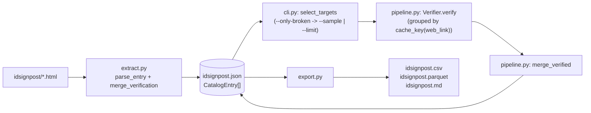

# `idsignpost` Project Overview and End-to-End Flow

This document summarizes what `idsignpost` does, how data moves through the package end to end, and where repository documentation diverges from the implementation. Every claim traces back to primary sources in `/root/idsignpost`.

## 1. Purpose and Scope

`idsignpost` preserves and maintains the Field Studies Council (FSC) Biodiversity ID Signpost, a catalog of 736 British and Irish wildlife identification guides originally published as static web pages (`README.md:16-33`, `pyproject.toml:5-8`).

The package (`src/idsignpost/`, version `0.1.0`, targeting Python 3.12+ with `uv_build` in `pyproject.toml:1-21`) replaces an older chain of ad-hoc scripts (`SPEC.md:7-18`). It solves three tasks:

1. **Direct extraction:** Parse 736 legacy HTML pages in `idsignpost/` (737 `.html` files total, excluding `about.html`) into typed `CatalogEntry` records in `idsignpost.json` (`src/idsignpost/extract.py:245-264`).
2. **Verification and recovery:** Check each primary `web_link` for HTTP liveness, inspect suspicious redirects with Gemini, search for live replacements for broken links with Gemini Google Search grounding, and look up (or capture) Wayback Machine snapshots (`src/idsignpost/pipeline.py:127-606`).
3. **Multi-format export:** Render the canonical `idsignpost.json` catalog deterministically into `idsignpost.csv`, `idsignpost.parquet`, and `idsignpost.md` (`src/idsignpost/export.py:64-209`).

As of the current checked-in `idsignpost.json` (736 entries):

- **Entries with `web_link`:** 714 (22 entries have `web_link: null`).
- **Link states:** 386 `ok`, 290 `broken`, 38 `blocked`, 22 `None`.
- **Wayback coverage:** 667 entries have a `wayback_link` (93.4% of linked entries; 90.6% of all 736 entries).
- **Recovered alternatives:** 93 broken entries carry a confirmed `alternative_link`.

---

## 2. Architecture and Module Map

| Module | Role | Primary Symbols |
|---|---|---|
| `src/idsignpost/__init__.py` | Package metadata | `__version__` (`L3`) |
| `src/idsignpost/cli.py` | CLI parser, `.env` loader, command dispatch | `main` (`L413`), `build_parser` (`L317`), `select_targets` (`L130`), `_cmd_extract` (`L60`), `_cmd_verify` (`L239`), `_cmd_export` (`L79`), `_cmd_run` (`L254`), `_cmd_cost` (`L92`) |
| `src/idsignpost/models.py` | Canonical Pydantic v2 catalog schema and loader | `CatalogEntry` (`L42`), `LinkState` (`L13`), `VERIFICATION_FIELDS` (`L15`), `CANONICAL_STATUS_ERRORS` (`L27`), `ensure_unique_ids` (`L103`), `load_catalog` (`L116`) |
| `src/idsignpost/urls.py` | URL sanitization, normalization, SSRF/private-IP guard | `sanitize_url` (`L58`), `cache_key` (`L79`), `clean_host` (`L84`), `normalized_url` (`L96`), `urls_equal` (`L110`), `is_public_http_url` (`L149`) |
| `src/idsignpost/extract.py` | Direct HTML-to-`CatalogEntry` parser and verification merger | `extract_catalog` (`L255`), `parse_entry` (`L156`), `slugify` (`L43`), `clean_text` (`L31`), `to_markdown` (`L91`), `merge_verification` (`L230`) |
| `src/idsignpost/http_checker.py` | Async bounded HTTP liveness checker and redirect heuristics | `HTTPChecker` (`L101`), `CheckResult` (`L52`), `parse_page` (`L86`), `_classify_code` (`L65`), `_is_suspicious` (`L214`) |
| `src/idsignpost/gemini_finder.py` | Gemini redirect check, grounded discovery, and page confirmation | `GeminiFinder` (`L176`), `Candidate` (`L39`), `RedirectVerdict` (`L46`), `Alternative` (`L52`), `DiscoveryOutcome` (`L59`), `is_blocked_host` (`L74`), `is_unusable_alternative` (`L82`) |
| `src/idsignpost/wayback.py` | Wayback Availability API lookup and Save Page Now capture | `WaybackClient` (`L30`), `lookup` (`L62`), `save` (`L79`) |
| `src/idsignpost/cache.py` | Two-tier atomic JSON cache (URL tier and entry tier) | `CatalogCache` (`L160`), `UrlRecord` (`L28`), `EntryRecord` (`L43`), `CACHE_VERSION` (`L16`), `SAVE_EVERY` (`L17`) |
| `src/idsignpost/cost.py` | Gemini token/search pricing and local 24h session ledger | `SessionCostTracker` (`L172`), `MODEL_RATES` (`L24`), `calculate_cost` (`L52`), `RunRecord` (`L127`) |
| `src/idsignpost/sampler.py` | Deterministic stratified sampling across link states | `get_stratified_sample` (`L38`), `BUCKET_ORDER` (`L9`) |
| `src/idsignpost/pipeline.py` | Async verification state machine and catalog merger | `Verifier` (`L127`), `VerifyStats` (`L84`), `OfflineRunError` (`L32`), `merge_verified` (`L608`) |
| `src/idsignpost/export.py` | Atomic exporters for JSON, CSV, Parquet, and Markdown | `atomic_write` (`L34`), `write_json` (`L70`), `write_csv` (`L85`), `write_parquet` (`L126`), `write_markdown` (`L207`), `display_state` (`L19`) |

---

## 3. CLI Entrypoints and Execution Flow

`pyproject.toml:20-21` registers the console script `idsignpost = "idsignpost.cli:main"`.

On startup, `main()` (`src/idsignpost/cli.py:413-419`):

1. Loads `.env` into `os.environ` (without overwriting existing variables) unless `PYTEST_CURRENT_TEST` is set (`cli.py:395-415`).
2. Parses subcommands via `build_parser()` (`cli.py:317-392`) and enables `logging.DEBUG` if `-v`/`--verbose` is passed.
3. Dispatches to one of five subcommands (`cli.py:35-41`):
   - **`extract`**: Parses `--html-dir` (default `idsignpost`). If `--limit N` is passed without `--output`, prints JSON to stdout without touching `idsignpost.json` (`cli.py:65-68`). Otherwise loads any existing canonical catalog at `--output` (default `idsignpost.json`), carries forward verification fields for entries with unchanged `web_link` via `merge_verification`, and atomically writes JSON (`cli.py:44-57,70-76`).
   - **`verify`**: Validates flags (`_usage_error`, returning exit code `2` on invalid usage), requires `GEMINI_API_KEY` (exit code `1` if missing), loads the full canonical catalog, selects targets (`--only-broken` first, then mutually exclusive `--sample N` or `--limit N`), runs `Verifier.verify` asynchronously, merges updated entries back into the full catalog via `merge_verified`, writes the full catalog atomically, saves `.url_cache.json` and `.idsignpost_costs.json`, and prints a summary plus cost breakdown to stderr (`cli.py:105-251`).
   - **`export`**: Loads `--input` (default `idsignpost.json`) and writes `--csv`, `--parquet`, and `--md` atomically (`cli.py:79-89`).
   - **`run`**: Executes full `extract` (merging previous verification fields), runs `verify` on the selected slice (`--only-broken` / `--sample` / `--limit` apply only to verification), and runs `export` only if verification succeeds without aborting (`cli.py:254-281`).
   - **`cost`**: Loads `.idsignpost_costs.json` via `SessionCostTracker.load` and prints an aligned session table, prints JSON (`--json`), or clears the session (`--reset`) (`cli.py:92-102`).

Exit codes across commands (`cli.py:60-281`): `0` on success (even when broken links remain), `1` on fatal/runtime errors (missing API key, corrupt catalog, `OfflineRunError`), and `2` on invalid CLI arguments.

---

## 4. End-to-End Data and Verification Pipeline

### 4.1 Stage 1: Direct HTML Extraction (`src/idsignpost/extract.py`)

`extract_catalog()` (`extract.py:255-264`) reads sorted `*.html` files excluding `about.html` (case-insensitively, `extract.py:245-252`) and calls `parse_entry()` (`extract.py:156-227`):

- **Scope isolation:** Parses inside `
` only (`extract.py:159-161`) and strips `.link-wrapper` and `.tabs` (`extract.py:163-164`) so sidebar filter widgets cannot pollute fields.
- **Title and identity:** Extracts `<h1>` as `title` (decomposing it from the DOM) and derives `id` via `slugify()` (`extract.py:43-54`: strip `.html`, NFKD-normalize to ASCII, lowercase, replace non-alphanumeric runs with `-`). `ensure_unique_ids()` rejects duplicate IDs (`extract.py:263`).
- **Submission metadata:** Parses `.meta.submitted` with `_SUBMITTED` (`extract.py:20-24,140-153`), storing naive site-local ISO 8601 (`YYYY-MM-DDTHH:MM:SS`) in `submitted_at`.
- **Text and link repair:** `clean_text()` (`extract.py:31-40`) runs `html.unescape` twice (for double-escaped legacy entities like `&amp;#13;`), replaces `\u00a0` and `\r`, and collapses whitespace. `_merge_trailing_link_text()` (`extract.py:68-76`) and `_fix_split_urls()` (`extract.py:79-84`) repair broken Flickr anchors (`<a href="...">...</a>@N07/...`).
- **Markdown and URL sanitization:** `field-description`, `body`, and `comment-body` are converted via `markdownify` with angle-bracketed links (`to_markdown`, `extract.py:91-97`). `field-web-link` and `field-additional-web-link` unescape HTML entities once more (`_sanitize_href`, `extract.py:114-116`) before calling `urls.sanitize_url()` (`urls.py:58-70`), which resolves relative URLs against `https://www.fscbiodiversity.uk/idsignpost/`, strips tracking parameters (`utm_*`, `fbclid`, `gclid`, `msclkid`, `mc_cid`, `mc_eid`, `ref`, `srsltid` in `urls.py:14-24,40-55`), and preserves original query byte-encoding when no tracking parameters are present.
- **Verification preservation:** `merge_verification()` (`extract.py:230-242`) copies all `VERIFICATION_FIELDS` (`models.py:15-25`) from a prior canonical catalog whenever `entry.id` matches and `entry.web_link` is unchanged.

### 4.2 Stage 2: Async Verification Pipeline (`src/idsignpost/pipeline.py`)

`Verifier.verify()` (`pipeline.py:152-188`) validates unique IDs, groups entries with a `web_link` by `cache_key(entry.web_link)` (sanitized URL with fragment stripped, `urls.py:79-81`), and schedules one `_verify_group()` task per distinct URL. If any task raises (such as `OfflineRunError`), remaining tasks are cancelled immediately (`pipeline.py:167-179`).

Within `_verify_group()` (`pipeline.py:233-255`), guarded by the HTTP concurrency semaphore (`DEFAULT_CONCURRENCY = 10`, `pipeline.py:27`):

1. **URL-tier facts (`_facts`, `pipeline.py:257-301`):**
   - Checks `CatalogCache.get_url(url)` unless `--refresh` is set.
   - On cache miss, runs `HTTPChecker.check(url, entry_title=entry.title)` (`http_checker.py:139-169`):
     - Bounded streaming `GET` (`MAX_HTML_BYTES = 16 * 1024`, `MAX_REDIRECTS = 10`, browser headers, `http_checker.py:14-29,186-211`).
     - Retries `400` and `403` once with plain `GET` (`PLAIN_HEADERS`, `http_checker.py:30,35,144-145,193-197`).
     - Classifies status codes (`_classify_code`, `http_checker.py:65-76`):
       - `200..399` -> `("ok", cacheable=True)`
       - `404, 410` -> `("broken", cacheable=True)`
       - `400, 401, 403, 405, 451` and other `4xx` -> `("blocked", cacheable=True)`
       - `429, 500, 502, 503, 504` and other codes -> `("blocked", cacheable=False)`
     - Maps exceptions (`_from_exception`, `http_checker.py:171-184`): `TimeoutException` -> `("timeout", "blocked", cacheable=False)`, `ConnectError` -> `("connect_error", "broken", cacheable=False)`, `TooManyRedirects` / `RemoteProtocolError` / `InvalidURL` -> `"broken"` (`cacheable=True`), other `HTTPError` -> `("http_error", "blocked", cacheable=False)`.
     - **Offline guard:** `HTTPChecker.should_abort()` (`http_checker.py:131-137`) aborts the run with `OfflineRunError` (`pipeline.py:278-281`) if `checks >= 10`, `responses_seen == 0`, and `network_failures >= checks`.
     - Extracts `<title>`, `<h1>`, and up to 800 characters of cleaned body text (`parse_page`, `http_checker.py:86-98`).
     - Flags `is_suspicious_redirect` (`http_checker.py:157-159,214-233`) when `resolved_url` differs from `url` (via `urls_equal`) and any of five heuristics fire: clean host changed, non-root path collapsed to `/`, soft-404 phrases in path/title, generic hub path (`/shop`, `/shop/publications`, `/product-category`, `/resources`, `/search`, `/category`) with an `entry_title`, or login/consent phrases in path/title.
   - Stores cacheable results in the URL tier of `.url_cache.json`.

2. **Per-entry verdicts (`_verdict`, `pipeline.py:303-451`):**
   - Runs concurrently for all entries sharing the URL.
   - **Transient HTTP failure:** Preserves existing verification fields if `entry.web_link_state is not None`; otherwise records the provisional state/status without setting `verified_at` or writing to cache (`pipeline.py:312-327,571-581`).
   - **Suspicious redirect check (`state == "ok"` and `is_suspicious_redirect`):** Reads `redirect_is_match` from entry cache or calls `GeminiFinder.verify_redirect()` under `_gemini` semaphore (`DEFAULT_GEMINI_CONCURRENCY = 3`, `pipeline.py:28,336-354,453-466`) using `verification_model` with Google Search grounding **disabled** (`gemini_finder.py:317-323`). If Gemini fails transiently (`verdict is None`), keeps the entry unchanged (`keep=True`). If `is_match` is `False`, transitions to `state = "broken"`, `status = "redirect_mismatch"`.
   - **Alternative discovery (`state == "broken"`):**
     - If entry cache has `alternative_checked == True`: reuses the cached alternative (dropping it if `is_unusable_alternative` matches, or running a one-time `_reconfirm` if `alternative_confirmed` is `False`, `pipeline.py:364-387,474-511`).
     - Otherwise calls `GeminiFinder.find_alternative()` (`gemini_finder.py:408-452`), which tries any previously stored `preferred` alternative first, then calls `discover()` (`gemini_finder.py:358-406`) using `discovery_model` with Google Search grounding **enabled** (`search=True`, bounded by `--max-searches`).
     - Each candidate (with `probability >= min_probability`, default `0.40`) passes `_try_candidate()` (`gemini_finder.py:468-510`):
       1. Policy check (`_policy_note`, `gemini_finder.py:454-466`): `http`/`https` only, not on `BLOCKED_HOSTS` (`fscbiodiversity.uk`, `tombio.uk`, `archive.org`, `web.archive.org`, `ebay.co.uk`, `ebay.com`, `zvab.com`, `scribd.com`, matched by exact host or dot-suffix), not an image file extension, not a site homepage (`""` or `"/"`), not equal to the broken `web_link`, and passes `is_public_http_url()` (no userinfo; DNS resolution must yield only public IPs, `urls.py:149-178`).
       2. Liveness check via `HTTPChecker.check`; requires `cacheable`, `state == "ok"`, and not `is_suspicious_redirect`.
       3. Post-redirect policy check on `resolved_url` (`gemini_finder.py:486-489`).
       4. Confirmation via `confirm_alternative()` (`gemini_finder.py:326-356`) using `verification_model` with Google Search **disabled**, inspecting title, `<h1>`, and 800-char snippet. A failed API call does not reject a live candidate; an explicit `is_match == False` rejects it and records `rejected: <reason>`.
     - Stores the final resolved URL as `alternative_link` and records `alternative_note` (`confirmed: ...` or up to 3 rejection/drop notes).
   - **State cleanup:** Whenever final `state != "broken"`, clears `alternative_link`, `alternative_probability`, `alternative_reasoning`, and `alternative_note` (`pipeline.py:400-401,591-600`).

3. **Wayback archival (`_wayback` and `_alternative_wayback`, `pipeline.py:530-559`):**
   - Queries `WaybackClient.lookup()` (`wayback.py:62-77`, Availability API, semaphore default `2`, 3 attempts with `2s`/`4s` backoff, accepts only `closest.status == "200"`, upgrades `http://web.archive.org` to `https://`).
   - If no snapshot exists, `--save-archive` is enabled, and any entry in the group is `ok` (non-transient), calls `WaybackClient.save()` (`wayback.py:79-90`, Save Page Now, 60s timeout, hard cap `SAVE_CONCURRENCY = 2`, skips on HTTP 429).
   - **Alternative fallback:** If a broken entry has no snapshot for its original `web_link` and has a non-transient `alternative_link`, runs `_alternative_wayback()` (lookup + optional Save Page Now) and caches the snapshot under the alternative URL (`pipeline.py:242-249,548-559`).

4. **Post-run hub pruning (`_drop_shared_alternatives`, `pipeline.py:190-231`):**
   - Any `alternative_link` assigned to 3 or more entries (`SHARED_ALTERNATIVE_LIMIT = 3`) is treated as a category hub, cleared from those entries, restored to the original URL's Wayback snapshot, and cached as a negative verdict (`dropped: URL shared by three or more entries`).

### 4.3 Stage 3: Multi-Format Exporters (`src/idsignpost/export.py`)

All four writers sort entries deterministically by `entry.id` (`export.py:24-25`) and write through `atomic_write()` (`export.py:34-57`: `tempfile.mkstemp` in target directory, chmod to caller's umask, `Path.replace`):

- **JSON (`write_json`, `L64-72`):** 2-space indented UTF-8 array keeping canonical `blocked` state.
- **CSV (`write_csv`, `L75-94`):** UTF-8 with `snake_case` headers matching `CatalogEntry.model_fields`, list fields joined by `"; "`, and `blocked` rendered as `unverified` via `display_state()` (`L19-21`).
- **Parquet (`write_parquet`, `L97-131`):** Lazy-imports `pyarrow`; native types (`pa.bool_()` for `is_free`, `pa.list_(pa.string())` for `available_as` and `additional_web_links`, `pa.float64()` for `alternative_probability`, `pa.string()` for all others); `blocked` rendered as `unverified`.
- **Markdown (`write_markdown`, `L134-209`):** Sections titled `## <filename>` with bulleted fields, angle-bracketed links, two-space indentation for multiline values, and `blocked` rendered as `unverified`.

---

## 5. Schemas, Caching, and Cost Tracking

### 5.1 Canonical Schema (`src/idsignpost/models.py`)

`CatalogEntry` (`models.py:42-100`) enforces `ConfigDict(extra="forbid")` and validates:

- `web_link_status`: Either a 3-digit HTTP status string (`^[1-5]\d{2}$`) or a member of `CANONICAL_STATUS_ERRORS` (`connect_error`, `timeout`, `protocol_error`, `too_many_redirects`, `invalid_url`, `http_error`, `redirect_mismatch`, `models.py:27-39,73-80`).
- `web_link_state`: `Literal["ok", "broken", "blocked"] | None` (`models.py:13,64`).
- `submitted_at`: Naive ISO 8601 site-local timestamp (`models.py:82-90`).
- `verified_at`: UTC ISO 8601 timestamp (`utcoffset() == timedelta(0)`, `models.py:92-100`).
- `alternative_probability`: Float in `[0.0, 1.0]` (`models.py:68`).

### 5.2 Two-Tier Cache (`src/idsignpost/cache.py`)

`.url_cache.json` (gitignored, `.gitignore:29`) uses `schema_version = 2` (`cache.py:16`), default TTL `30` days (`cache.py:18`), and auto-saves every `25` writes (`SAVE_EVERY = 25`, `cache.py:17,268-271`) plus on clean exit or `KeyboardInterrupt` (`cli.py:177-183`):

- **`urls` tier (`UrlRecord`, `cache.py:28-39`):** Keyed by `cache_key(url)`. Stores HTTP status, state, `resolved_url`, `is_suspicious_redirect`, `page_title`, `page_h1`, `page_snippet`, `wayback_url`, and `checked_at`.
- **`entries` tier (`EntryRecord`, `cache.py:43-63`):** Keyed by `f"{entry_id}::{cache_key(url)}"`. Stores `redirect_is_match`, `redirect_reason`, `alternative_url`, `alternative_probability`, `alternative_reasoning`, `alternative_note`, `alternative_checked`, `alternative_confirmed`, and `checked_at`.
- Non-matching schema versions or malformed JSON are discarded on load (`cache.py:180-185`). Transient results (`cacheable=False`) are never stored (`cache.py:217-227,247-262`). Expired records are stripped on `save()` (`cache.py:273-287`).

### 5.3 Session Cost Tracking (`src/idsignpost/cost.py`)

`SessionCostTracker` (`cost.py:172-406`) persists run records to `.idsignpost_costs.json` (gitignored, `.gitignore:30`) with a 24-hour inactivity rollover (`DEFAULT_SESSION_TTL_HOURS = 24.0`, `cost.py:14,378-383`). `GeminiFinder._record_usage()` (`gemini_finder.py:244-276`) extracts `prompt_token_count`, `candidates_token_count`, `cached_content_token_count`, and `grounding_metadata.web_search_queries` from each Gemini response and logs costs per operation (`redirect_verification`, `candidate_discovery`, `candidate_confirmation`). Pricing rates per 1M tokens and per 1,000 search queries are defined in `MODEL_RATES` (`cost.py:24-31`), with `gemini-3.1-flash-lite` priced at `$0.25` input / `$1.50` output / `$0.02` cached per 1M tokens and `$14.00` per 1,000 grounded searches.

---

## 6. External Integrations

1. **Target websites (`httpx`):** Async streaming GET via `HTTPChecker` (`http_checker.py:101-212`).
2. **Google Gemini (`google-genai`):** Async `client.aio.models.generate_content` via `GeminiFinder` (`gemini_finder.py:194-289`), defaulting to `gemini-3.1-flash-lite` (`DEFAULT_MODEL`, `gemini_finder.py:17`). Requires `GEMINI_API_KEY`. Search grounding is attached only for `candidate_discovery`.
3. **Internet Archive Wayback Machine (`httpx`):** Availability API (`https://archive.org/wayback/available`) and Save Page Now (`https://web.archive.org/save/`) via `WaybackClient` (`wayback.py:14-15,62-90`).

---

## 7. Test Suite (`tests/`)

`pyproject.toml:32-38` configures pytest with `addopts = "-m 'not live'"`, `asyncio_mode = "auto"`, and a `live` marker. Collecting tests yields **282 offline tests** plus **1 deselected live smoke test** (283 total across 13 files, 3,706 lines):

| Test File | Tests (`def test_`) | Coverage Focus |
|---|---|---|
| `tests/test_cache.py` | 14 | Two-tier isolation, TTL expiry, v1 discard, atomic saves, transient exclusion |
| `tests/test_cli.py` | 20 | Subcommands, flag validation, exit codes, target selection, full-catalog merge |
| `tests/test_cost.py` | 9 | Pricing table, cost calculation, session rollover, formatting, persistence |
| `tests/test_export.py` | 9 | Deterministic JSON/CSV/Parquet/Markdown output, native Arrow types, `blocked` -> `unverified` |
| `tests/test_extract.py` | 18 | Fixture parsing (`tests/fixtures/`), double entities, Flickr split URLs, slugs, verification merge |
| `tests/test_gemini_finder.py` | 39 | Candidate ranking, JSON parsing, retries, blocklist suffix matching, SSRF guard, confirmation, search caps |
| `tests/test_http_checker.py` | 15 | Status mapping (`respx`), 400/403 retry, HTML snippet parsing, suspicious redirects, offline guard |
| `tests/test_models.py` | 12 | `CatalogEntry` validation, status regex/errors, timestamp rules, duplicate ID rejection |
| `tests/test_pipeline.py` | 30 | Full state machine, shared URL grouping, transient preservation, hub pruning, Wayback fallback |
| `tests/test_sampler.py` | 11 | Stratified buckets, shortfall redistribution, clamping, determinism |
| `tests/test_urls.py` | 13 | Sanitization, tracking params, fragment stripping, normalization, private-IP rejection |
| `tests/test_wayback.py` | 11 | Availability lookup, status-200 filter, retries, Save Page Now timeout and 429 handling |
| `tests/test_live_smoke.py` | 1 | `@pytest.mark.live` check against 3 sampled corpus links (`HTTPChecker` + `WaybackClient`) |

---

## 8. Discrepancies Between Docs and Source Code

Auditing `README.md`, `SPEC.md`, `NARRATIVE.md`, and `plans/README.md` against `src/idsignpost/`, `tests/`, `pyproject.toml`, and `idsignpost.json` surfaced the following gaps and drift:

1. **Outdated test count badge (`README.md:7` vs `tests/`):** `README.md:7` displays `tests-265 passed`, while `uv run pytest --collect-only` collects 282 offline tests (283 including the live smoke test).
2. **`cost` subcommand and model/budget flags missing from `README.md`:** `src/idsignpost/cli.py:35-41,92-102,288,301-313,373-391` implements `idsignpost cost` (`--cost-file`, `--reset`, `--json`) and verification options `--cost-file`, `--verification-model`, `--discovery-model`, and `--max-searches`. `README.md` omits all of these (they are documented in `SPEC.md:359-374` and `NARRATIVE.md:281-289`).
3. **CSV column names and `--min-prob` default in `README.md`:**
   - `README.md:59-75` tells spreadsheet users to filter Title-cased columns (`Keywords`, `Title`, `Free`, `Web link`, `Wayback link`, `Web link state`, `Alternative link`, `Alternative probability`), but `src/idsignpost/export.py:15,85-94` writes `snake_case` headers (`keywords`, `title`, `is_free`, `web_link`, `wayback_link`, `web_link_state`, `alternative_link`, `alternative_probability`).
   - `README.md:41,199` describes `blocked` as a state in the catalog without noting that `idsignpost.csv`, `idsignpost.parquet`, and `idsignpost.md` relabel `blocked` as `unverified` (`src/idsignpost/export.py:19-21,78-79,119-120,184`).
   - `README.md:192` shows `--min-prob 0.6` while the actual default is `0.40` (`src/idsignpost/cli.py:299`, `src/idsignpost/gemini_finder.py:19`).
   - `README.md:131` uses a placeholder clone URL (`https://github.com/your-username/idsignpost.git`) instead of `charlesroper/FSCLegacy-fscbiodiversity.uk-idsignpost` (`AGENTS.md:59`).
4. **Sampler bucket count (`SPEC.md:327` and `NARRATIVE.md:51` vs `src/idsignpost/sampler.py:9-14`):** `SPEC.md:327` says entries are partitioned into 3 buckets (`ok`, `broken`, `blocked`), and `NARRATIVE.md:51` names a fourth bucket `missing`. The implementation in `src/idsignpost/sampler.py:9-14` uses 4 buckets: `("ok", "broken", "blocked", "unverified")`.
5. **Gemini timeout retry claim (`NARRATIVE.md:157` vs `src/idsignpost/gemini_finder.py:167-173,224-242`):** `NARRATIVE.md:157` states Gemini retries "on 429, 5xx, and timeouts". In `src/idsignpost/gemini_finder.py:167-173`, `_retryable()` only checks for HTTP `429` or `500..599` codes/tokens; `asyncio.TimeoutError` does not match `_retryable()` and returns `None` immediately without retrying.
6. **Undocumented `.env` auto-loading (`src/idsignpost/cli.py:395-415`):** `main()` automatically loads `.env` when not running under pytest, but neither `README.md` nor `SPEC.md` mentions `.env` support.
7. **`discover(..., hint=...)` not wired into CLI/pipeline (`SPEC.md:227` vs `src/idsignpost/gemini_finder.py:358-452`):** `GeminiFinder.discover()` accepts `hint: str | None = None`, but `find_alternative()` and `Verifier` never pass `hint`; it is only usable programmatically or in tests.
8. **HTTP checker implementation nuances (`SPEC.md:193-213` vs `src/idsignpost/http_checker.py`):**
   - `http_checker.py:65-76` classifies any unlisted `4xx` as `("blocked", True)` and any other unlisted code as `("blocked", False)`.
   - `http_checker.py:193-197` performs the `400`/`403` retry with non-streaming `client.get()` (buffering the full response before slicing to 16 KB) rather than streaming.
   - `http_checker.py:157-159` only runs `_is_suspicious()` when `resolved_url is not None`, so a non-redirecting `200 OK` soft-404 page is not flagged.
9. **Testing section and dev dependency omissions in `SPEC.md`:** `SPEC.md:88` omits `pytest-asyncio` (present in `pyproject.toml:26`), and `SPEC.md:388-402` omits `tests/test_models.py` and `tests/test_cost.py` from the Section 8 numbered list (even though both appear in the directory tree at `SPEC.md:73,78`).
10. **Minor historical/plan metadata drift:** `NARRATIVE.md:238` reports an earlier catalog state (92 alternatives, 40 blocked) versus the current `idsignpost.json` (93 alternatives, 290 broken, 38 blocked), and `plans/README.md:23` still lists `Commits: Pending` for the completed `2026-10-29-gemini-model-optimisation-and-cost-tracking.md` plan.
